# Architecture

Archipel is a **modular monolith** built on NestJS. Each platform library is a self-contained NestJS module that can be composed into any application independently. The libraries enforce strict boundaries between business logic and infrastructure through well-defined contracts.

## Key Patterns

### Abstract Bases & Adapters

The central pattern is **Abstract Bases & Adapters** (Hexagonal Architecture). Platform libraries define abstract **abstract bases** — contracts you implement — and your application provides concrete **adapters** — implementations backed by your specific data source, API, or logic.

Abstract classes serve as both the **type contract** and the **NestJS DI token**. This eliminates the need for separate `Symbol()` or string tokens while preserving full type safety.

For implementation details, code examples, and the complete abstract base reference table, see the [Implementing Adapters](/guides/implementing-adapters) guide.

### Dynamic Module Registration

Every library exposes a static `register()` method that returns a `DynamicModule`. This is where your application provides abstract base implementations and configuration. No module uses global state or hidden defaults — everything is explicit at registration time.

```typescript
AuthModule.register({
    authSubject: PrismaAuthSubjectAdapter,
    mfaSubject: PrismaMfaSubjectAdapter,
    sessionPersistence: PrismaSessionAdapter,
    verificationSubject: PrismaVerificationAdapter,
});
```

### Application Bootstrap

`platform-bootstrap` composes app-level startup concerns as ordered `PlatformBootstrapStep` functions. The consuming app still creates the Nest application with `NestFactory` and the selected HTTP adapter, then applies reusable `use*` helpers for API defaults, middleware, security, sessions, and OpenAPI.

For the reusable rules and examples, see the [Bootstrap Pattern](/patterns/bootstrap-pattern) and [Application Bootstrap](/guides/application-bootstrap) guide.

### Strategy Pattern

Several libraries support pluggable strategies for different provider implementations:

- **`platform-mailing`** supports SMTP, Postmark, Resend, Plunk, and Log delivery strategies behind a common `DeliveryStrategyBase`.
- **`platform-blob-storage`** supports Vercel Blob, Azure Blob Storage, AWS S3, and local filesystem out of the box, plus custom strategies via `BlobStorageStrategyBase`.
- **`platform-documents`** supports pluggable renderers for DOCX, PDF, and image processing.
- **`platform-authentication`** supports JWT, Local, Anonymous, and OAuth strategies (GitHub, Google, Microsoft, Apple).
- **`platform-payments`** supports Stripe, LemonSqueezy, Paddle, and Mollie behind a common `PaymentClientBase`.
- **`platform-esigning`** supports DocuSign, Adobe Sign, Dropbox Sign, and a built-in internal provider behind a common `EsigningClientBase`.
- **`platform-analytics`** supports Sentry, Azure Application Insights, and Datadog behind a common `AnalyticsClientBase`.
- **`platform-queue`** supports MemoryQueue, BullMQ (Redis), Azure Service Bus, and Vercel Queues behind a common `IQueue` interface.
- **`platform-intelligence`** exposes provider-neutral language, embedding, media, reranking, realtime, agent, file, and skill facades. Injectable adapters for OpenAI, Anthropic, Google, xAI/Grok, Xiaomi MiMo, and Vercel AI Gateway live behind independent tree-shakable package subpaths and a common provider abstract base.

- **`platform-intelligence-agents`** is the orchestration layer above `platform-intelligence`: explicit multi-agent environments, semantic events, situations, isolated memory, interceptable loops and an optional adapter for the shared MCP client. Applications retain product identities, authorization, persistence and scheduling.

You select the strategy at module registration time. Each package's documentation page lists the available options.

### Mapping Service

`platform-mapping` provides a centralized `MappingService` for transforming domain entities into response DTOs. Mapping logic lives in dedicated `MappingProfileBase` subclasses — not in services or controllers. Mapping keys are branded constants for type-safe, collision-free lookups.

---

## Dependency Graph

```mermaid
flowchart TB
  Core[platform-core\nFoundation]
  PlatformBootstrap[platform-bootstrap\nApplication Bootstrap]

  Configuration[platform-configuration]
  Mapping[platform-mapping]
  Resources[platform-resources]
  Health[platform-health]
  Caching[platform-caching\nRedis]
  Cryptography[platform-cryptography]
  Logging[platform-logging\nSentry]
  Telemetry[platform-telemetry\nOTel + numeric measurements]

  OpenApi[platform-openapi\nSwagger]
  Database[platform-database\nPrisma]
  BlobStorage[platform-blob-storage]
  Queue[platform-queue]

  Authentication[platform-authentication]
  Payments[platform-payments]
  Mailing[platform-mailing]

  Documents[platform-documents\nStandalone]
  Reporting[platform-reporting\nStandalone]
  Mcp[platform-mcp\nStandalone]
  Esigning[platform-esigning\nStandalone]
  Intelligence[platform-intelligence\nStandalone]
  IntelligenceAgents[platform-intelligence-agents\nOrchestration]
  IntelligenceAgents --> Intelligence
  IntelligenceAgents --> Mcp
  Analytics[platform-analytics\nStandalone]

  PlatformBootstrap --> Configuration
  PlatformBootstrap --> Core
  PlatformBootstrap --> Database
  PlatformBootstrap --> OpenApi
  PlatformBootstrap --> Resources

  Core --> Configuration
  Core --> Mapping
  Core --> Resources
  Core --> Health
  Core --> Caching
  Core --> Cryptography
  Core --> Logging
  Core --> Telemetry
  Core --> OpenApi
  Core --> Database
  Core --> BlobStorage
  Core --> Queue

  Database --> Authentication
  Database --> Payments
  Database --> Mailing
  BlobStorage --> Mailing

  Core --> Documents
  Core --> Reporting
  Core --> Mcp
  Core --> Esigning
  Core --> Intelligence
  Core --> Analytics
```



---

## Design Rules

1. **`platform-core` has no Archipel dependencies** — it is the foundation that everything else builds on.
2. **Tier 1 libraries** (`platform-mapping`, `platform-resources`, `platform-health`) depend only on `platform-core` and external packages.
3. **No horizontal dependencies** — libraries at the same layer never depend on each other.
4. **Dependencies flow downward** — higher-layer libraries depend only on lower layers and core.
5. **No circular dependencies** — enforced structurally, not by convention.
6. **Abstract bases are abstract classes** — serving as both type contract and DI token.
7. **Adapters live in your application** — never inside platform libraries.
8. **No global state** — every module is explicitly configured at registration time.
9. **No leaking internals** — only symbols exported from the package barrel are considered public API.
10. **Bounded collections** — every in-memory collection has a static upper limit to prevent unbounded memory growth.
11. **Graceful lifecycle** — modules implement `OnModuleInit` for eager setup and `OnModuleDestroy` with timeouts for clean teardown.
12. **Platform errors** — each library owns typed errors; HTTP-facing errors can carry their status directly, while infrastructure errors use a dedicated filter where needed.

---

## Error Handling

Platform libraries define errors for their own capabilities. Some extend `Error` or a library base class, while HTTP-facing errors may extend `ProblemDetailException`. A consuming application owns its business-domain errors. Notable platform error hierarchies:

| Library                 | Error Classes                                                                                                             |
| ----------------------- | ------------------------------------------------------------------------------------------------------------------------- |
| `platform-mapping`      | `MappingErrorBase`, `MappingNotRegisteredError`, `TypeMappingNotRegisteredError`                                          |
| `platform-resources`    | `ResourceNotFoundError`                                                                                                   |
| `platform-mailing`      | `MailDeliveryError`                                                                                                       |
| `platform-payments`     | `PaymentError`                                                                                                            |
| `platform-intelligence` | `IntelligenceProviderError`, `IntelligenceConfigurationError`, `IntelligenceValidationError`, `IntelligenceRealtimeError` |
| `platform-cryptography` | `CryptoValidationError`                                                                                                   |
| `platform-documents`    | `DocumentErrorBase`, `TemplateError`, `RenderError`, `ExportError`                                                        |
| `platform-esigning`     | `EsigningError`, `EsigningWebhookError`                                                                                   |
| `platform-reporting`    | `ReportingDatasetNotFoundError`                                                                                           |

---

## Lifecycle Management

Libraries implement NestJS lifecycle hooks for deterministic startup and teardown:

| Phase          | Hook              | Examples                                                                                                                                                                   |
| -------------- | ----------------- | -------------------------------------------------------------------------------------------------------------------------------------------------------------------------- |
| **Eager init** | `OnModuleInit`    | `MetricsService` creates instruments, `McpDiscoveryService` scans providers                                                                                                |
| **Teardown**   | `OnModuleDestroy` | `AnalyticsClientBase.flush()`, `OtelSdkHolder.shutdown()`, `McpServerService` closes transports, `IntelligenceRealtimeSessionFactory` closes sessions and flushes metering |

Teardown operations use **timeout guards** (typically 5 seconds) to prevent processes from hanging when external services are unreachable.

---

## Resource Bounds

All in-memory collections enforce static upper limits:

| Library                 | Component                        | Limit  | Behavior when exceeded               |
| ----------------------- | -------------------------------- | ------ | ------------------------------------ |
| `platform-core`         | `SseHub` event subjects          | 10,000 | Throws error                         |
| `platform-health`       | `HealthOrchestrator` indicators  | 100    | Logs warning, skips registration     |
| `platform-reporting`    | `ContributorRegistry`            | 200    | Logs warning, skips registration     |
| `platform-mcp`          | `McpServerService` transports    | 1,000  | Bounded tracking                     |
| `platform-esigning`     | `InternalEsigningProvider`       | 10,000 | Throws error                         |
| `platform-intelligence` | `IntelligenceToolRegistry` tools | 128    | Throws `IntelligenceValidationError` |
| `platform-intelligence` | Realtime sessions per instance   | 1,000  | Rejects session creation             |
| `platform-intelligence` | Realtime queues per session      | 512    | Applies backpressure or closes       |
