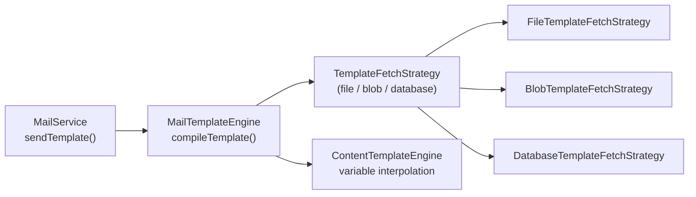
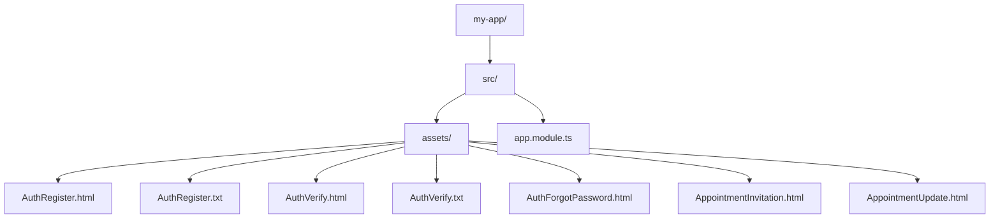

# Email Templates

This guide explains how to create email templates for `platform-mailing` and register them with `ResourceManager` from `platform-resources`. It covers the template syntax, the built-in template names, how to provide your own HTML/TXT files, and how to override library defaults.

> **Prerequisite:** You should be familiar with [Email Delivery](/guides/email-delivery) for general mail setup and [Resource Management](/guides/resource-management) for how `ResourceManager` strategies work.

---

## How It Works

`platform-mailing` does **not** ship ready-made template files. It defines a list of known template **names** and loads the actual content through a **template-fetch strategy** at startup. Each strategy is available as a dedicated subpath export:

| Strategy     | Subpath Import                                                 | Description                                      |
| ------------ | -------------------------------------------------------------- | ------------------------------------------------ |
| **File**     | `@pixel-brewery/archipel-platform-mailing/templating/file`     | Load from local filesystem via `ResourceManager` |
| **Blob**     | `@pixel-brewery/archipel-platform-mailing/templating/blob`     | Load from blob storage via `BlobService`         |
| **Database** | `@pixel-brewery/archipel-platform-mailing/templating/database` | Load from database via `IMailTemplateRepository` |



1. `MailService.sendTemplate()` passes the template name and context variables to `MailTemplateEngine`.
2. `MailTemplateEngine` delegates to the configured `TemplateFetchStrategy` (file, blob, or database) to load the template content.
3. `ContentTemplateEngine` from `platform-core` interpolates `{{placeholders}}` with the provided context.
4. The compiled string is handed to the configured delivery strategy (SMTP, Resend, Postmark, etc.).

---

## Built-In Template Names

`FileTemplateFetchStrategy` expects these template names. For each name, both `.html` and `.txt` variants are loaded (if available):

| Template Name           | Purpose                                    |
| ----------------------- | ------------------------------------------ |
| `AuthRegister`          | Welcome email sent after user registration |
| `AuthVerify`            | Email address verification with token/link |
| `AuthForgotPassword`    | Password reset email with token/link       |
| `AppointmentInvitation` | Invitation to an appointment or event      |
| `AppointmentUpdate`     | Notification about an appointment change   |

The strategy loads `AuthRegister.html`, `AuthRegister.txt`, `AuthVerify.html`, etc. Missing variants are silently skipped — you can provide only `.html` if you don't need plain-text fallbacks.

---

## Creating Template Files

### Template Syntax

::: v-pre

Templates use a Handlebars-style syntax powered by `ContentTemplateEngine`:

| Syntax                                   | Description                    |
| ---------------------------------------- | ------------------------------ |
| `{{variableName}}`                       | Simple variable substitution   |
| `{{#if condition}}...{{/if}}`            | Conditional block              |
| `{{#if condition}}...{{else}}...{{/if}}` | Conditional with else          |
| `{{#unless condition}}...{{/unless}}`    | Negative conditional           |
| `{{#each items}}...{{/each}}`            | Loop over array                |
| `{{#with object}}...{{/with}}`           | Context switching              |
| `{{@index}}`, `{{@first}}`, `{{@last}}`  | Loop metadata inside `#each`   |
| `{{nested.property}}`                    | Dot notation for nested values |

### Example: `AuthVerify.html`

```text
<!DOCTYPE html>
<html>
<head>
  <meta charset="utf-8" />
  <title>Verify your email</title>
</head>
<body>
  <h1>Hello, {{userName}}!</h1>
  <p>Please verify your email address by clicking the link below:</p>
  <p>
    <a href="{{verificationUrl}}">Verify Email</a>
  </p>
  {{#if expiresInHours}}
  <p>This link expires in {{expiresInHours}} hours.</p>
  {{/if}}
  <p>If you did not create an account, you can safely ignore this email.</p>
</body>
</html>
```

### Example: `AuthVerify.txt`

```text
Hello, {{userName}}!

Please verify your email address by visiting the following link:

{{verificationUrl}}

{{#if expiresInHours}}This link expires in {{expiresInHours}} hours.{{/if}}

If you did not create an account, you can safely ignore this email.
```

:::

### Security

When the format is `html`, `MailTemplateEngine` automatically **escapes all context values** (`&`, `<`, `>`, `"`, `'`) before interpolation to prevent XSS in email clients. Plain-text templates (`txt`) are not escaped.

---

## Registering Templates with ResourceManager

### File-Based Templates (Recommended)

Place your template files in your application's assets directory and register the path with `ResourceModule`:



```typescript
import { Module } from '@nestjs/common';
import { join } from 'node:path';
import { ResourceModule, FileResourceStrategy } from '@pixel-brewery/archipel-platform-resources';
import { MailModule } from '@pixel-brewery/archipel-platform-mailing';
import { FileTemplateFetchStrategy } from '@pixel-brewery/archipel-platform-mailing/templating/file';

@Module({
    imports: [
        ResourceModule.forRoot({
            strategies: [
                new FileResourceStrategy({
                    basePaths: [join(import.meta.dirname, 'assets')],
                    includeSubfolders: true,
                }),
            ],
        }),
        MailModule.register({
            deliveryStrategy: ResendDeliveryStrategy,
            templateFetchStrategy: FileTemplateFetchStrategy,
            templateNames: ['AuthRegister', 'AuthVerify', 'AuthForgotPassword', 'AppointmentInvitation', 'AppointmentUpdate'],
        }),
    ],
})
export class AppModule {}
```

The template names are passed directly to `MailModule.register()` via the `templateNames` option. `FileTemplateFetchStrategy` uses these names to load the corresponding `.html` and `.txt` files from `ResourceManager`.

### Blob-Based Templates

For templates managed via a CMS or shared across multiple services, use `BlobTemplateFetchStrategy` from the `templating/blob` subpath. Upload a manifest file (`templates/templates.json`) and the template files to your blob storage:

```typescript
import { BlobTemplateFetchStrategy } from '@pixel-brewery/archipel-platform-mailing/templating/blob';
```

**`templates/templates.json`**

```json
["templates/AuthRegister.html", "templates/AuthRegister.txt", "templates/AuthVerify.html", "templates/AuthVerify.txt", "templates/AuthForgotPassword.html"]
```

The `BlobTemplateFetchStrategy` downloads the manifest, then fetches each listed file from blob storage via `BlobService` from `platform-blob-storage`. Select this strategy by passing it to `MailModule.register()`:

```typescript
import { MailModule } from '@pixel-brewery/archipel-platform-mailing';
import { BlobTemplateFetchStrategy } from '@pixel-brewery/archipel-platform-mailing/templating/blob';

MailModule.register({
    deliveryStrategy: ResendDeliveryStrategy,
    templateFetchStrategy: BlobTemplateFetchStrategy,
});
```

### Database-Based Templates

For templates stored in a database (e.g., managed via an admin panel), use `DatabaseTemplateFetchStrategy` from the `templating/database` subpath:

```typescript
import { DatabaseTemplateFetchStrategy } from '@pixel-brewery/archipel-platform-mailing/templating/database';
```

This strategy loads templates through the `IMailTemplateRepository` abstract base. You must provide an adapter implementation that fetches template records from your database:

```typescript
import { DatabaseTemplateFetchStrategy } from '@pixel-brewery/archipel-platform-mailing/templating/database';
import { IMailTemplateRepository, MAIL_TEMPLATE_REPOSITORY_TOKEN } from '@pixel-brewery/archipel-platform-mailing';
import { MailModule } from '@pixel-brewery/archipel-platform-mailing';

MailModule.register({
    deliveryStrategy: SmtpDeliveryStrategy,
    templateFetchStrategy: DatabaseTemplateFetchStrategy,
    templateRepositoryProvider: {
        provide: MAIL_TEMPLATE_REPOSITORY_TOKEN,
        useClass: PrismaMailTemplateRepository,
    },
});
```

---

## Overriding Library Templates

If a library ships default template files in its `assets/` folder, you can override them by listing your application's assets directory **before** the library path:

```typescript
ResourceModule.forRoot({
    strategies: [
        new FileResourceStrategy({
            basePaths: [
                join(import.meta.dirname, 'assets'), // ← Your overrides (checked first)
                join(import.meta.dirname, '..', 'node_modules', '@pixel-brewery', 'archipel-platform-mailing', 'assets'),
            ],
            includeSubfolders: true,
        }),
    ],
});
```

`ResourceManager` tries strategies and base paths in order — the first match wins. By placing your directory first, any file you provide takes precedence.

---

## Sending a Templated Email

Once templates are registered, use `MailService.sendTemplate()`:

```typescript
import { Injectable } from '@nestjs/common';
import { MailService } from '@pixel-brewery/archipel-platform-mailing';

@Injectable()
export class RegistrationService {
    private readonly _mailService: MailService;

    constructor(mailService: MailService) {
        this._mailService = mailService;
    }

    public async sendWelcomeEmail(email: string, userName: string): Promise<void> {
        await this._mailService.sendTemplate(
            {
                to: email,
                subject: 'Welcome to our platform',
            },
            {
                templateName: 'AuthRegister',
                templateParams: {
                    userName,
                    dashboardUrl: 'https://yourapp.com/dashboard',
                    year: new Date().getFullYear(),
                },
            },
        );
    }
}
```

The `templateName` must match one of the registered template file names (without extension). The `templateParams` object is passed to the template engine for variable substitution.

---

## Template Format Selection

The environment variable `MAIL_TEMPLATE_ENGINE_FORMAT` controls which variant is used:

| Value  | Behavior                                        |
| ------ | ----------------------------------------------- |
| `html` | Sends HTML email using `TemplateName.html`      |
| `txt`  | Sends plain-text email using `TemplateName.txt` |

---

## Debugging

If a template is not found at runtime, `MailTemplateEngine.compileTemplate()` throws with the message:

```
Template with key 'AuthVerify' not found.
```

To diagnose, enable `debug: true` in `ResourceModule.forRoot()`. This logs every available resource at startup so you can verify that your template files are discovered:

```
[FileResourceStrategy] Available resources:
  - AuthVerify.html (text/html, 1.2 KB) → /app/dist/assets/AuthVerify.html
  - AuthVerify.txt (text/plain, 320 B) → /app/dist/assets/AuthVerify.txt
```

Also check that your `MailModule.register()` call passes the correct `templateFetchStrategy` class (`FileTemplateFetchStrategy`, `BlobTemplateFetchStrategy`, or `DatabaseTemplateFetchStrategy`).

---

## Checklist

- [ ] Template files created for all required template names (`.html` and/or `.txt`)
- [ ] `ResourceModule.forRoot()` registered with base paths including your template directory (for `file` strategy)
- [ ] `MailModule.register()` called with the correct `templateFetchStrategy` class
- [ ] `templateNames` passed to `MailModule.register()` (for `FileTemplateFetchStrategy`)
- [ ] `MAIL_TEMPLATE_ENGINE_FORMAT` set to `html` or `txt`
- [ ] Placeholders in templates match the keys passed in `templateParams`
- [ ] App-level overrides listed **before** library asset paths in `basePaths`
- [ ] `debug: true` used during development to verify template availability
- [ ] Only the needed templating subpath is imported (tree-shaking)

---

## Next Steps

- See the [Email Delivery](/guides/email-delivery) guide for provider setup, attachments, and verification flows
- See the [Resource Management](/guides/resource-management) guide for advanced strategies (blob, caching, custom strategies)
- See the [Document Generation](/guides/document-generation) guide for PDF/DOCX template rendering
- Browse the [platform-mailing API reference](/packages/platform-mailing/api/) for complete method signatures
