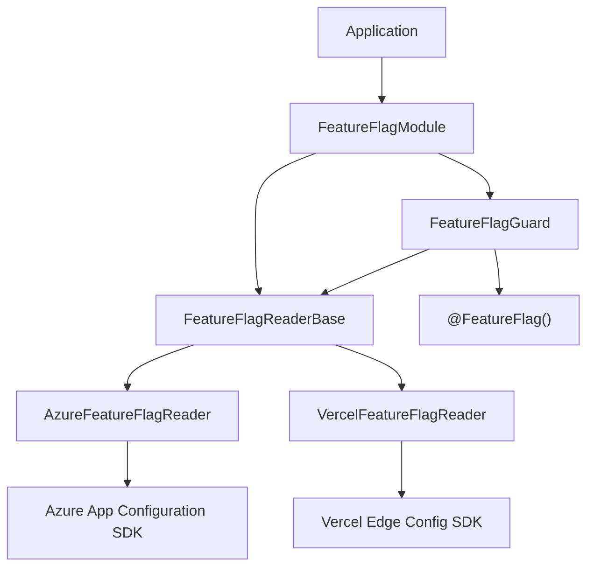

# Feature Flags

This guide covers feature flag management with `platform-feature-flags`: choosing a provider, evaluating flags and variants, protecting routes with a guard, and refreshing flag state at runtime.

---

## Installation

```bash
yarn add @pixel-brewery/archipel-platform-feature-flags
```

---

## Choose a Provider

`platform-feature-flags` abstracts feature flag operations behind a `FeatureFlagReaderBase`. Supported providers:

| Provider                    | Subpath Import                                          | SDK                                                                   | Best for                                     |
| --------------------------- | ------------------------------------------------------- | --------------------------------------------------------------------- | -------------------------------------------- |
| **Azure App Configuration** | `@pixel-brewery/archipel-platform-feature-flags/azure`  | `@azure/app-configuration-provider` + `@microsoft/feature-management` | Enterprise apps with Azure infrastructure    |
| **Vercel Edge Config**      | `@pixel-brewery/archipel-platform-feature-flags/vercel` | `@vercel/edge-config`                                                 | Vercel-hosted apps needing low-latency reads |

Install the provider SDK you need:

```bash
# Azure
yarn add @azure/app-configuration-provider @microsoft/feature-management @azure/identity

# Vercel
yarn add @vercel/edge-config
```

---

## Configuration

### Azure App Configuration

| Variable                              | Required | Description                                                       |
| ------------------------------------- | -------- | ----------------------------------------------------------------- |
| `AZURE_APPCONFIG_ENDPOINT`            | No*      | Azure App Configuration endpoint URL. Required for Entra ID auth. |
| `AZURE_APPCONFIG_CONNECTION_STRING`   | No*      | Connection string. Alternative to endpoint + Entra ID.            |
| `AZURE_FEATURE_FLAG_REFRESH_INTERVAL` | No       | Refresh interval in ms. Defaults to `30000`.                      |
| `AZURE_FEATURE_FLAG_KEY_FILTER`       | No       | Key filter for selecting flags. Defaults to `*` (all).            |

> \* At least one of `AZURE_APPCONFIG_ENDPOINT` or `AZURE_APPCONFIG_CONNECTION_STRING` must be set.

### Vercel Edge Config

| Variable                     | Required | Description                                                         |
| ---------------------------- | -------- | ------------------------------------------------------------------- |
| `EDGE_CONFIG`                | Yes      | Vercel Edge Config connection string (includes store ID and token). |
| `VERCEL_EDGE_CONFIG_TOKEN`   | No       | Read access token (when not embedded in connection string).         |
| `VERCEL_FEATURE_FLAG_PREFIX` | No       | Key prefix in Edge Config. Defaults to `featureFlags`.              |

### Using Config Keys

Import the typed config entries and pass them to the module:

```typescript
import { AZURE_FEATURE_FLAG_CONFIG_ENTRIES } from '@pixel-brewery/archipel-platform-feature-flags/azure';
import { VERCEL_FEATURE_FLAG_CONFIG_ENTRIES } from '@pixel-brewery/archipel-platform-feature-flags/vercel';
```

---

## Module Registration

### Azure Provider

```typescript
import { Module } from '@nestjs/common';
import { FeatureFlagModule } from '@pixel-brewery/archipel-platform-feature-flags';
import { AzureFeatureFlagReader, AZURE_FEATURE_FLAG_CONFIG_ENTRIES } from '@pixel-brewery/archipel-platform-feature-flags/azure';

@Module({
    imports: [
        FeatureFlagModule.register({
            featureFlagReader: AzureFeatureFlagReader,
            configEntries: [...AZURE_FEATURE_FLAG_CONFIG_ENTRIES],
        }),
    ],
})
export class AppModule {}
```

### Vercel Provider

```typescript
import { Module } from '@nestjs/common';
import { FeatureFlagModule } from '@pixel-brewery/archipel-platform-feature-flags';
import { VercelFeatureFlagReader, VERCEL_FEATURE_FLAG_CONFIG_ENTRIES } from '@pixel-brewery/archipel-platform-feature-flags/vercel';

@Module({
    imports: [
        FeatureFlagModule.register({
            featureFlagReader: VercelFeatureFlagReader,
            configEntries: [...VERCEL_FEATURE_FLAG_CONFIG_ENTRIES],
        }),
    ],
})
export class AppModule {}
```

The module is registered **globally** by default. Pass `isGlobal: false` to scope it to a feature module.

---

## Evaluating Feature Flags

Inject the `FeatureFlagReaderBase` to evaluate flags in your services:

### Simple On/Off Flags

```typescript
import { Injectable } from '@nestjs/common';
import { FeatureFlagReaderBase } from '@pixel-brewery/archipel-platform-feature-flags';

@Injectable()
export class CheckoutService {
    private readonly _featureFlagReader: FeatureFlagReaderBase;

    public constructor(featureFlagReader: FeatureFlagReaderBase) {
        this._featureFlagReader = featureFlagReader;
    }

    public async processCheckout(userId: string): Promise<void> {
        const useNewFlow = await this._featureFlagReader.isEnabled('new-checkout-flow', {
            userId,
        });

        if (useNewFlow) {
            // New checkout logic
        } else {
            // Legacy checkout logic
        }
    }
}
```

### Multivariate Flags / A/B Testing

Use `getVariant()` to retrieve typed variant values for experiments and graduated rollouts:

```typescript
const tier = await this._featureFlagReader.getVariant<string>(
    'pricing-tier',
    'free', // default value
    { userId },
);

const maxUploadMb = await this._featureFlagReader.getVariant<number>(
    'max-upload-size',
    10, // default value
);
```

### Listing All Flags

Retrieve every known flag with its current state — useful for debugging or admin dashboards:

```typescript
const flags = await this._featureFlagReader.getAllFlags();
// [{ key: 'new-checkout-flow', enabled: true }, { key: 'dark-mode', enabled: false }]
```

---

## Route Guard

The `FeatureFlagGuard` combined with the `@FeatureFlag()` decorator lets you gate entire endpoints behind a feature flag:

```typescript
import { Controller, Get, UseGuards } from '@nestjs/common';
import { FeatureFlagGuard, FeatureFlag } from '@pixel-brewery/archipel-platform-feature-flags';

@Controller('experiments')
export class ExperimentController {
    @Get('new-dashboard')
    @UseGuards(FeatureFlagGuard)
    @FeatureFlag('new-dashboard')
    public async getNewDashboard(): Promise<string> {
        return 'Welcome to the new dashboard!';
    }
}
```

When the flag is **disabled**, the guard returns `false` and NestJS responds with `403 Forbidden`. If no `@FeatureFlag()` metadata is set, the guard allows access unconditionally.

The guard automatically passes the `userId` from `request.user` (if available) to the flag evaluation context, enabling per-user targeting.

---

## Evaluation Context

Both `isEnabled()` and `getVariant()` accept an optional `IFeatureFlagContext` for targeting and segmentation:

```typescript
await this._featureFlagReader.isEnabled('beta-feature', {
    userId: 'usr_abc123',
    groups: ['beta-testers', 'enterprise'],
    attributes: {
        region: 'eu-west',
        plan: 'pro',
    },
});
```

| Property     | Type                      | Description                                         |
| ------------ | ------------------------- | --------------------------------------------------- |
| `userId`     | `string`                  | Unique user identifier for per-user targeting.      |
| `groups`     | `ReadonlyArray<string>`   | Segments the user belongs to (e.g. beta, internal). |
| `attributes` | `Record<string, unknown>` | Custom key-value pairs for targeting rules.         |

> **Note:** How the context is evaluated depends on the provider. Azure App Configuration uses targeting filters configured in the portal. Vercel Edge Config does not natively support targeting — context is available for custom evaluation logic.

---

## Refreshing Flag State

### Azure

The Azure provider automatically refreshes flag state in the background at the configured interval (`AZURE_FEATURE_FLAG_REFRESH_INTERVAL`). You can also trigger an immediate refresh:

```typescript
await this._featureFlagReader.refresh();
```

### Vercel

Vercel Edge Config is near-realtime. The `refresh()` method is a no-op — changes propagate automatically at the edge.

---

## Health Checks

Both providers implement a `ping()` method that returns `true` if the provider is reachable. Integrate it with `platform-health` for monitoring:

```typescript
import { Injectable } from '@nestjs/common';
import { FeatureFlagReaderBase } from '@pixel-brewery/archipel-platform-feature-flags';

@Injectable()
export class FeatureFlagHealthIndicator {
    private readonly _reader: FeatureFlagReaderBase;

    public constructor(reader: FeatureFlagReaderBase) {
        this._reader = reader;
    }

    public async isHealthy(): Promise<boolean> {
        return this._reader.ping();
    }
}
```

---

## Error Handling

All provider errors are wrapped in a `FeatureFlagError` with the provider name and original cause:

```typescript
import { FeatureFlagError } from '@pixel-brewery/archipel-platform-feature-flags';

try {
    await featureFlagReader.isEnabled('some-flag');
} catch (error) {
    if (error instanceof FeatureFlagError) {
        console.error(`Provider: ${error.provider}, Message: ${error.message}`);
        // error.cause contains the original SDK error
    }
}
```

Map `FeatureFlagError` to an appropriate HTTP response in your global exception filter.

---

## Architecture



---

## Vercel Edge Config Data Structure

Vercel Edge Config expects feature flags to be stored as a single object under the configured prefix key:

```json
{
    "featureFlags": {
        "new-checkout-flow": true,
        "dark-mode": false,
        "pricing-tier": "enterprise",
        "max-upload-size": 100
    }
}
```

- Boolean values map to simple on/off flags (`isEnabled` returns the boolean directly).
- Non-boolean values are returned as variants (`getVariant` returns the value as-is).

---

## Testing

Mock the `FeatureFlagReaderBase` in unit tests:

```typescript
import { Test } from '@nestjs/testing';
import { FeatureFlagReaderBase } from '@pixel-brewery/archipel-platform-feature-flags';

const mockReader = {
    isEnabled: vi.fn().mockResolvedValue(true),
    getVariant: vi.fn().mockResolvedValue('enterprise'),
    getAllFlags: vi.fn().mockResolvedValue([]),
    refresh: vi.fn().mockResolvedValue(undefined),
    ping: vi.fn().mockResolvedValue(true),
};

const module = await Test.createTestingModule({
    providers: [{ provide: FeatureFlagReaderBase, useValue: mockReader }, CheckoutService],
}).compile();
```

See the [Testing guide](./testing) for more patterns.
