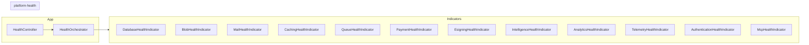

# Health Indicators

Every Archipel platform library ships an optional **health indicator** as a separate `/health` subpath export. Health indicators implement the `IHealthIndicator` interface from `platform-health` and can be registered with the `HealthModule` to build a unified `/health` endpoint for your application.

## Architecture



The `HealthOrchestrator` aggregates all registered `IHealthIndicator` instances and returns a combined result. Each indicator reports its own key and status independently.

## Prerequisites

- `@pixel-brewery/archipel-platform-health` installed
- `@nestjs/terminus` installed (peer dependency)

## IHealthIndicator Interface

Every health indicator implements this contract:

```typescript
interface IHealthIndicator {
    /** Unique key identifying this indicator in the health response. */
    readonly key: string;

    /** Run the health check and return a Terminus HealthIndicatorResult. */
    check(): HealthIndicatorResult | Promise<HealthIndicatorResult>;
}
```

## Available Indicators

All 12 platform libraries provide a health indicator via their `/health` subpath:

| Library                   | Subpath Import                                           | Class                           | Key              | Check Behavior                                                                          |
| ------------------------- | -------------------------------------------------------- | ------------------------------- | ---------------- | --------------------------------------------------------------------------------------- |
| `platform-database`       | `@pixel-brewery/archipel-platform-database/health`       | `DatabaseHealthIndicator`       | `database`       | Prisma `SELECT 1` ping                                                                  |
| `platform-blob-storage`   | `@pixel-brewery/archipel-platform-blob-storage/health`   | `BlobHealthIndicator`           | `blob`           | HTTP ping to blob URL (or `disabled` if unconfigured)                                   |
| `platform-mailing`        | `@pixel-brewery/archipel-platform-mailing/health`        | `MailHealthIndicator`           | `mail`           | Validates mail host, user, and abstract base config                                     |
| `platform-caching`        | `@pixel-brewery/archipel-platform-caching/health`        | `CachingHealthIndicator`        | `caching`        | Always `up`                                                                             |
| `platform-queue`          | `@pixel-brewery/archipel-platform-queue/health`          | `QueueHealthIndicator`          | `queue`          | Always `up`                                                                             |
| `platform-payments`       | `@pixel-brewery/archipel-platform-payments/health`       | `PaymentHealthIndicator`        | `payment`        | Calls `PaymentClientBase.ping()` to verify provider connectivity                        |
| `platform-esigning`       | `@pixel-brewery/archipel-platform-esigning/health`       | `EsigningHealthIndicator`       | `esigning`       | Calls `EsigningClientBase.ping()` to verify provider connectivity, reports `providerId` |
| `platform-intelligence`   | `@pixel-brewery/archipel-platform-intelligence/health`   | `IntelligenceHealthIndicator`   | `intelligence`   | Runs a bounded provider probe and reports capability plus realtime state                |
| `platform-analytics`      | `@pixel-brewery/archipel-platform-analytics/health`      | `AnalyticsHealthIndicator`      | `analytics`      | Calls `AnalyticsClientBase.ping()` to verify provider readiness                         |
| `platform-telemetry`      | `@pixel-brewery/archipel-platform-telemetry/health`      | `TelemetryHealthIndicator`      | `telemetry`      | Checks `OtelSdkHolder.isInitialized` for SDK presence                                   |
| `platform-authentication` | `@pixel-brewery/archipel-platform-authentication/health` | `AuthenticationHealthIndicator` | `authentication` | Always `up`                                                                             |
| `platform-mcp`            | `@pixel-brewery/archipel-platform-mcp/health`            | `McpHealthIndicator`            | `mcp`            | Checks tool/resource/prompt registry counts, reports breakdown                          |

### Indicator Categories

**Active checks** — perform a real probe:

- `DatabaseHealthIndicator` — executes a SQL ping
- `BlobHealthIndicator` — sends an HTTP request to the blob URL
- `MailHealthIndicator` — validates configuration values
- `PaymentHealthIndicator` — calls `PaymentClientBase.ping()` (adapters can override for real API calls)
- `EsigningHealthIndicator` — calls `EsigningClientBase.ping()` (adapters can override for real API calls)
- `IntelligenceHealthIndicator` — probes the default language provider with an independent three-second timeout
- `AnalyticsHealthIndicator` — calls `AnalyticsClientBase.ping()` (adapters can override for SDK readiness checks)

**State checks** — inspect in-memory state (zero-cost, no I/O):

- `TelemetryHealthIndicator` — checks whether the OpenTelemetry SDK has been initialized
- `McpHealthIndicator` — verifies at least one tool/resource/prompt handler is registered

**Stub checks** — always report `up`:

- `CachingHealthIndicator`, `QueueHealthIndicator`, `AuthenticationHealthIndicator`

## Quick Start

### 1. Register Indicators

Use `HealthModule.withIndicators()` to register the indicators you need:

```typescript
import { Module } from '@nestjs/common';
import { HealthModule } from '@pixel-brewery/archipel-platform-health';
import { DatabaseHealthIndicator } from '@pixel-brewery/archipel-platform-database/health';
import { MailHealthIndicator } from '@pixel-brewery/archipel-platform-mailing/health';
import { PaymentHealthIndicator } from '@pixel-brewery/archipel-platform-payments/health';
import { CachingHealthIndicator } from '@pixel-brewery/archipel-platform-caching/health';

@Module({
    imports: [
        // ... your feature modules
        HealthModule.withIndicators([DatabaseHealthIndicator, MailHealthIndicator, PaymentHealthIndicator, CachingHealthIndicator]),
    ],
})
export class AppModule {}
```

### 2. Expose a Health Endpoint

The `HealthOrchestrator` runs all registered indicators and returns an aggregated result:

```typescript
import { Controller, Get } from '@nestjs/common';
import { HealthOrchestrator } from '@pixel-brewery/archipel-platform-health';

@Controller('health')
export class HealthController {
    constructor(private readonly _health: HealthOrchestrator) {}

    @Get()
    public async check() {
        return this._health.check();
    }
}
```

### 3. Example Response

```json
{
    "status": "ok",
    "details": {
        "database": { "status": "up" },
        "mail": { "status": "up" },
        "payment": { "status": "up" },
        "caching": { "status": "up" },
        "intelligence": {
            "status": "up",
            "providerStatus": "operational",
            "provider": "openai",
            "model": "gpt-5.4-mini",
            "failureCode": null,
            "realtime": {
                "enabled": true,
                "providers": ["openai", "google"],
                "activeSessions": 2
            }
        },
        "mcp": { "status": "up", "tools": 5, "resources": 2, "prompts": 1 },
        "telemetry": { "status": "up", "sdkInitialized": true }
    }
}
```

When a provider is not registered (e.g., no `PaymentClientBase` injected), the indicator reports:

```json
{
    "payment": { "status": "up", "disabled": true }
}
```

When an intelligence probe fails unexpectedly, the indicator reports a stable
failure code without leaking provider transport details:

```json
{
    "intelligence": {
        "status": "down",
        "failureCode": "INTELLIGENCE_HEALTH_CHECK_FAILED"
    }
}
```

## Writing a Custom Indicator

Implement `IHealthIndicator` to create a health check for your own services:

```typescript
import { Injectable } from '@nestjs/common';
import { IHealthIndicator } from '@pixel-brewery/archipel-platform-health';
import type { HealthIndicatorResult } from '@nestjs/terminus';

@Injectable()
export class SearchHealthIndicator implements IHealthIndicator {
    public readonly key = 'search';

    public check(): HealthIndicatorResult<'search'> {
        return { search: { status: 'up' } };
    }
}
```

Register it alongside built-in indicators:

```typescript
HealthModule.withIndicators([DatabaseHealthIndicator, SearchHealthIndicator]);
```

## Tree-Shaking

Health indicators are **not** included in the main library entry point. They are exported from a separate `/health` subpath, so they are fully tree-shakeable. If you don't import the health subpath, the indicator code and its `@nestjs/terminus` peer dependency are never bundled.

## Peer Dependencies

Each health indicator requires these optional peer dependencies:

| Package                                   | Notes                                           |
| ----------------------------------------- | ----------------------------------------------- |
| `@pixel-brewery/archipel-platform-health` | `IHealthIndicator` interface and `HealthModule` |
| `@nestjs/terminus`                        | `HealthIndicatorResult` type                    |

Both are listed as optional peer dependencies in each library's `package.json`.
