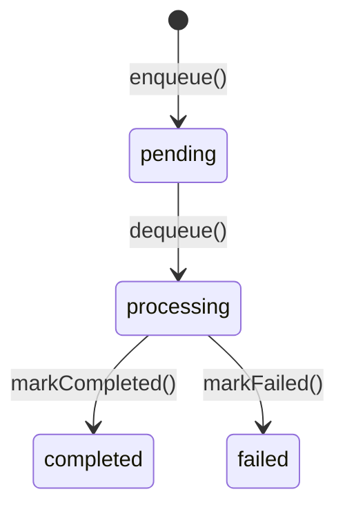

# Queue Infrastructure

This guide covers job queue infrastructure with `platform-queue`: choosing between in-memory, Redis-backed, and Azure Service Bus backends, managing job lifecycles, handling errors, and switching providers without code changes.

---

## Installation

```bash
yarn add @pixel-brewery/archipel-platform-queue
```

For BullMQ (Redis), also install the SDK:

```bash
yarn add bullmq
```

For Azure Service Bus:

```bash
yarn add @azure/service-bus
```

For Vercel Queues:

```bash
yarn add @vercel/queue
```

---

## Configuration

### Core Variables

```dotenv
QUEUE_MAX_JOBS=10000
```

`QUEUE_MAX_JOBS` is optional and only applies to `MemoryQueue`. When omitted, the default of `10_000` is used.

### BullMQ Variables

```dotenv
BULLMQ_REDIS_URL=redis://localhost:6379
BULLMQ_PREFIX=myapp:
```

`BULLMQ_REDIS_URL` is required when using `BullMqQueue`. `BULLMQ_PREFIX` is optional (defaults to empty string).

### Azure Service Bus Variables

```dotenv
AZURE_CONNECTION_STRING=Endpoint=sb://my-namespace.servicebus.windows.net/;SharedAccessKeyName=...;SharedAccessKey=...
AZURE_RECEIVE_WAIT_MS=5000
```

`AZURE_CONNECTION_STRING` is required when using `AzureQueue`. `AZURE_RECEIVE_WAIT_MS` is optional (defaults to `5000`).

### Vercel Queues Variables

```dotenv
VERCEL_QUEUE_REGION=iad1
VERCEL_QUEUE_CONSUMER_GROUP=my-consumer
VERCEL_QUEUE_TOKEN=
VERCEL_QUEUE_DEPLOYMENT_ID=
VERCEL_QUEUE_VISIBILITY_TIMEOUT_SECONDS=300
```

`VERCEL_QUEUE_REGION` and `VERCEL_QUEUE_CONSUMER_GROUP` are required when using `VercelQueue`. `VERCEL_QUEUE_TOKEN` is auto-fetched via OIDC when omitted. `VERCEL_QUEUE_VISIBILITY_TIMEOUT_SECONDS` defaults to `300`.

### Using Config Keys

Import the typed config keys and pass them to your module registration:

```typescript
import { PLATFORM_QUEUE_CONFIG_ENTRIES } from '@pixel-brewery/archipel-platform-queue';
import { BULLMQ_CONFIG_ENTRIES } from '@pixel-brewery/archipel-platform-queue/bullmq';
import { AZURE_CONFIG_ENTRIES } from '@pixel-brewery/archipel-platform-queue/azure';
import { VERCEL_CONFIG_ENTRIES } from '@pixel-brewery/archipel-platform-queue/vercel';
```

---

## Concepts

`platform-queue` provides a generic `IQueue<TPayload>` interface with three implementations:

| Implementation | Backend           | Persistence | Best for                                     |
| -------------- | ----------------- | ----------- | -------------------------------------------- |
| `MemoryQueue`  | In-memory         | No          | Development, testing, single-instance apps   |
| `BullMqQueue`  | Redis via BullMQ  | Yes         | Multi-instance deployments, distributed jobs |
| `AzureQueue`   | Azure Service Bus | Yes         | Enterprise cloud messaging, peek-lock        |
| `VercelQueue`  | Vercel Queues     | Yes         | Serverless Vercel deployments                |

All implementations share the same `IQueue` contract, so switching providers requires only changing the import and constructor options — no business logic changes.

### Job Lifecycle

Every job follows a four-state lifecycle:



Each `IQueueJob` carries full metadata: `id`, `queueName`, `payload`, `status`, `attempts`, `createdAt`, `processedAt`, `completedAt`, `failedAt`, and an optional `errorMessage`.

---

## In-Memory Queue

### Basic Setup

`MemoryQueue` ships with the core entry point and requires no extra dependencies:

```typescript
import { Module } from '@nestjs/common';
import { MemoryQueue } from '@pixel-brewery/archipel-platform-queue';

@Module({
    providers: [
        {
            provide: 'IQueue',
            useFactory: () => new MemoryQueue({ maxJobs: 5_000 }),
        },
    ],
    exports: ['IQueue'],
})
export class QueueModule {}
```

### Capacity Eviction

When the total number of jobs across all named queues exceeds `maxJobs`, the oldest completed or failed jobs are evicted automatically. Pending and processing jobs are never evicted.

> **When to use:** Development, automated tests, or single-instance services where persistence is not required.

---

## BullMQ (Redis)

### Basic Setup

`BullMqQueue` creates Redis-backed queues that survive process restarts and can be shared across multiple instances:

```typescript
import { Module } from '@nestjs/common';
import { BullMqQueue } from '@pixel-brewery/archipel-platform-queue/bullmq';

@Module({
    providers: [
        {
            provide: 'IQueue',
            useFactory: () =>
                new BullMqQueue({
                    redisUrl: 'redis://localhost:6379',
                    prefix: 'myapp:',
                }),
        },
    ],
    exports: ['IQueue'],
})
export class QueueModule {}
```

### How It Works

Each named queue lazily creates its own BullMQ `Queue` and `Worker` instance. When `dequeue()` is called, the worker picks the next available job using a one-time token. Job tokens are tracked internally so that `markCompleted()` and `markFailed()` can transition jobs to their terminal state.

### Graceful Shutdown

`BullMqQueue` implements `OnModuleDestroy` and automatically closes all queues and workers when the NestJS module is destroyed. No manual cleanup is needed.

---

## Azure Service Bus

### Basic Setup

`AzureQueue` integrates with Azure Service Bus using peek-lock message handling:

```typescript
import { Module } from '@nestjs/common';
import { AzureQueue } from '@pixel-brewery/archipel-platform-queue/azure';

@Module({
    providers: [
        {
            provide: 'IQueue',
            useFactory: () =>
                new AzureQueue({
                    connectionString: 'Endpoint=sb://...',
                    receiveWaitMs: 5_000,
                }),
        },
    ],
    exports: ['IQueue'],
})
export class QueueModule {}
```

### How It Works

Senders and receivers are lazily created per queue name and cached for the lifetime of the instance. `enqueue()` sends a message to the queue, `dequeue()` receives the next message with peek-lock, `markCompleted()` completes the message, and `markFailed()` dead-letters it.

### Graceful Shutdown

`AzureQueue` implements `OnModuleDestroy` and automatically closes all senders, receivers, and the underlying `ServiceBusClient` when the module is destroyed.

---

## Vercel Queues

### Basic Setup

`VercelQueue` uses the official `@vercel/queue` SDK (`PollingQueueClient`) for durable, serverless message streaming on Vercel:

```typescript
import { Module } from '@nestjs/common';
import { VercelQueue } from '@pixel-brewery/archipel-platform-queue/vercel';

@Module({
    providers: [
        {
            provide: 'IQueue',
            useFactory: () =>
                new VercelQueue({
                    region: 'iad1',
                    consumerGroup: 'my-consumer',
                }),
        },
    ],
    exports: ['IQueue'],
})
export class QueueModule {}
```

### How It Works

`enqueue()` calls `send()` on the SDK to publish a message to the given topic. `dequeue()` calls `receive()`, which invokes a handler callback when a message is available. The handler is suspended via an internal gate promise until `markCompleted()` or `markFailed()` is called, at which point the handler completes and the SDK auto-acknowledges the message.

Both `markCompleted()` and `markFailed()` acknowledge (remove) the message. If retry behaviour is desired, re-enqueue the job explicitly.

### Authentication

When deployed on Vercel, the SDK auto-fetches an OIDC token. For local development, provide a `token` in the constructor options.

### Graceful Shutdown

`VercelQueue` implements `OnModuleDestroy` and releases all pending gates, causing in-flight SDK handlers to complete normally and acknowledge their messages.

---

## Usage in Services

Inject the `IQueue` token and use the same API regardless of the underlying provider:

```typescript
import { Injectable, Inject } from '@nestjs/common';
import { IQueue, QUEUE_JOB_STATUS } from '@pixel-brewery/archipel-platform-queue';

@Injectable()
export class InvoiceService {
    // #region Fields

    private readonly _queue: IQueue;

    // #endregion

    // #region Ctor

    constructor(@Inject('IQueue') queue: IQueue) {
        this._queue = queue;
    }

    // #endregion

    // #region Methods

    public async scheduleInvoice(invoiceId: number): Promise<void> {
        await this._queue.enqueue('invoices', { invoiceId });
    }

    public async processNext(): Promise<void> {
        const job = await this._queue.dequeue<{ invoiceId: number }>('invoices');

        if (!job) {
            return;
        }

        try {
            // ... process the invoice
            await this._queue.markCompleted(job.id);
        } catch (error) {
            await this._queue.markFailed(job.id, (error as Error).message);
        }
    }

    // #endregion
}
```

---

## Error Handling

All queue implementations throw domain-specific errors that extend `QueueError`:

| Error Class             | When Thrown                                            |
| ----------------------- | ------------------------------------------------------ |
| `QueueValidationError`  | Empty or whitespace-only queue name or error message   |
| `QueueJobNotFoundError` | Job ID does not exist in the underlying store          |
| `QueueJobStateError`    | Job is in the wrong state for the requested transition |

Handle these in your service layer or map them centrally via an exception filter:

```typescript
import { QueueJobNotFoundError, QueueJobStateError } from '@pixel-brewery/archipel-platform-queue';

try {
    await this._queue.markCompleted(jobId);
} catch (error) {
    if (error instanceof QueueJobNotFoundError) {
        this._logger.warn(`Job ${jobId} not found — may have been evicted.`);
    } else if (error instanceof QueueJobStateError) {
        this._logger.warn(`Job ${jobId} is not in processing state.`);
    } else {
        throw error;
    }
}
```

---

## Listing Jobs

Use `getJobs()` to retrieve all jobs for a named queue. This is useful for admin dashboards or monitoring:

```typescript
const jobs = await this._queue.getJobs('invoices');

const pending = jobs.filter((j) => j.status === QUEUE_JOB_STATUS.pending);
const failed = jobs.filter((j) => j.status === QUEUE_JOB_STATUS.failed);

this._logger.log(`Queue 'invoices': ${pending.length} pending, ${failed.length} failed`);
```

---

## Switching Providers

Swap the provider by changing the import — no business logic changes needed:

```typescript
// Before: in-memory
import { MemoryQueue } from '@pixel-brewery/archipel-platform-queue';
useFactory: () => new MemoryQueue({ maxJobs: 10_000 }),

// After: Redis
import { BullMqQueue } from '@pixel-brewery/archipel-platform-queue/bullmq';
useFactory: () => new BullMqQueue({ redisUrl: 'redis://localhost:6379' }),

// After: Azure Service Bus
import { AzureQueue } from '@pixel-brewery/archipel-platform-queue/azure';
useFactory: () => new AzureQueue({ connectionString: 'Endpoint=sb://...' }),
```

---

## Best Practices

| Practice                                 | Why                                                                  |
| ---------------------------------------- | -------------------------------------------------------------------- |
| Use `MemoryQueue` only for dev and tests | Data is lost on restart; not suitable for production workloads       |
| Set `maxJobs` for `MemoryQueue`          | Prevents unbounded memory growth in long-running processes           |
| Always handle `markFailed`               | Ensures failed jobs are properly tracked and not stuck in processing |
| Use typed payloads with generics         | `enqueue<T>()` and `dequeue<T>()` keep your job data type-safe       |
| Rely on `OnModuleDestroy` for cleanup    | Both `BullMqQueue` and `AzureQueue` close connections automatically  |
| Keep queue names short and descriptive   | e.g. `invoices`, `emails`, `reports` — avoid deeply nested names     |
| Wrap queue calls in services             | Never call `IQueue` directly from controllers                        |
