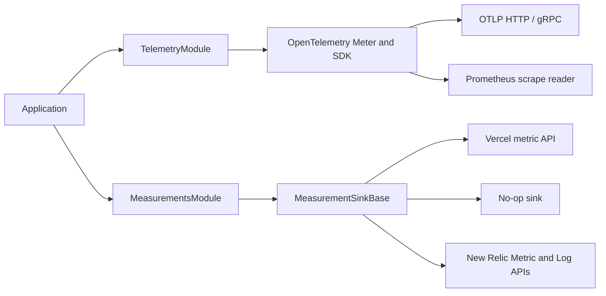

# Telemetry & Observability

`platform-telemetry` has two explicit recording paths. OpenTelemetry owns metric instruments, aggregation, tracing, and export. `measurements` handles individual numeric values for destinations such as Vercel Custom Metrics. The paths can be registered independently in the same application. The OpenTelemetry bootstrap composes the official meter and tracer providers directly; selecting an OTLP reader does not import the Prometheus or Vercel provider.



## OpenTelemetry path

Use Node.js 22.18.0 or later with OpenTelemetry API 1.10 and SDK 3.
Tracing uses `@opentelemetry/sdk-trace`, `@opentelemetry/context-async-hooks`,
and `@opentelemetry/core` for the provider, asynchronous context, and W3C propagation.
The former `sdk-trace-node` and `sdk-trace-base` packages are no longer required.

Import `TelemetryModule` and a reader from separate entry points. The SDK remains the only owner of counters, histograms, gauges, and their aggregation.

```typescript
import { TelemetryModule, MetricsService } from '@pixel-brewery/archipel-platform-telemetry/otel';
import { createOtlpHttpMetricReader } from '@pixel-brewery/archipel-platform-telemetry/otel/providers/otlp-http';

TelemetryModule.register({
    serviceName: 'api',
    metricReaders: [createOtlpHttpMetricReader()],
    httpMetricsInterceptor: true,
});
```

Inject `MetricsService` to call `recordCounter`, `recordHistogram`, or `recordGauge`. The telemetry facade, cache recorder, log rule engine, operation interceptor, and logger use that same OpenTelemetry path. `httpMetricsInterceptor` records completed HTTP request duration and count on OpenTelemetry instruments. `IMetricInstruments` and `getInstruments()` remain available for the built-in cache and operation instruments.

Reader entry points are `/otel/providers/otlp-http`, `/otel/providers/otlp-grpc`, `/otel/providers/prometheus`, and `/otel/providers/console`. The OTLP readers use the standard `OTEL_EXPORTER_OTLP_*` configuration. The Prometheus reader exposes its own scrape HTTP server on the selected port (default 9464); it is intended for long-running hosts. Alternatively, configure Prometheus's OTLP/HTTP receiver and use the OTLP/HTTP reader. Prometheus does not receive OTLP/gRPC directly.

Supplying `metricReaders` enables metric export. Explicit `metrics: { enabled: true }` requires at least one reader. Without readers, tracing can still run and the SDK receives an empty reader list, avoiding exporter selection through `OTEL_METRICS_EXPORTER`. SDK shutdown is bounded by `OtelSdkHolder`.

## Individual numeric measurements

Use the separate entry point when the destination takes one numeric value per call:

```typescript
import { MeasurementsModule, MeasurementsService } from '@pixel-brewery/archipel-platform-telemetry/measurements';
import { VercelMeasurementSink } from '@pixel-brewery/archipel-platform-telemetry/measurements/providers/vercel';

MeasurementsModule.register({ sink: VercelMeasurementSink, isGlobal: true, httpInterceptor: true });

// In an injected application service:
// measurements.record('order.created', 1, { channel: 'web' });
```

`MeasurementsService.record(name, value, attributes)` has no Counter, Gauge, or Histogram parameter. It records a finite number; the destination's query and aggregation determine its later interpretation. The two optional HTTP interceptors use one shared request lifecycle implementation and emit through their respective recording paths. Both use route templates, not concrete URLs. Nest guards may reject before an interceptor runs, so those rejections are outside its observations.

The Vercel sink uses `@vercel/functions` `metric()`. Each call is one Vercel data point. It validates Vercel's metric name and attribute limits and shortens long attribute values deterministically. Vercel currently permits up to 100 custom metric emissions per Function invocation; emitting two HTTP values per request consumes two of them. A local test can verify calls to `metric()`; actual dashboard ingestion requires a deployed Function invocation. Use `/measurements/providers/empty` for an explicit no-op sink.

## Why the paths are separate

OpenTelemetry exporters receive aggregated metric points. For a histogram those points contain count, sum, and buckets, not the original recorded values. Vercel's `metric()` receives one number per call. Sending an aggregate to Vercel as though it were a raw observation can change the meaning of totals and distributions. The numeric path preserves the original value when it is recorded, while the OpenTelemetry path keeps its standard metric semantics.

The former `MetricClientPort` treated OpenTelemetry, Prometheus, and Vercel as equivalent metric clients. Its `/strategies/*` entry points and the independent Prometheus registry/controller are removed. Applications now select OpenTelemetry readers under `/otel/providers/*` or a direct sink under `/measurements/providers/*`; both families have separate package exports and optional SDK peers.

## Operational diagnostics and New Relic

The optional `diagnostics` registration adds `DiagnosticsService` to the existing measurement path. `complete(operation, durationMs, outcome, context)` emits `${operation}_total` and `${operation}_duration_ms`; `gauge(name, value)` emits a gauge. Use static operation names and bounded context values. `failure(component, operation, error, context, { correlate })` emits `operational_failures_total` and a sanitized local error log. The original thrown object is never serialized.

The host supplies `classifyFailure` and `getCorrelationId` callbacks. Without a classifier, failures have `failure.kind=unknown`, `error.code=UNKNOWN`, and `cause.code=UNKNOWN`. Callback exceptions use that fallback and never replace the application error. A classifier must return only safe attributes. Use `{ correlate: false }` for background work, including work initiated by HTTP. When diagnostics and `httpInterceptor` are enabled, the existing interceptor reports exceptions with status >=500 and rethrows the same value; client errors and guard failures before the interceptor are outside this alarm path. HTTP duration and count still have a single recording owner.

The New Relic adapter is available only through `/measurements/providers/new-relic`. It uses Node's HTTP fetch implementation and needs no New Relic agent SDK. Register its configuration entries and explicit destination options:

```typescript
import { ConfigModule, EnvironmentConfigStrategy } from '@pixel-brewery/archipel-platform-configuration';
import { MeasurementsModule } from '@pixel-brewery/archipel-platform-telemetry/measurements';
import {
    NewRelicMeasurementSink,
    NEW_RELIC_CONFIG_ENTRIES,
    NEW_RELIC_MEASUREMENT_OPTIONS,
} from '@pixel-brewery/archipel-platform-telemetry/measurements/providers/new-relic';

// Application module imports:
ConfigModule.forRoot({ strategyFactory: () => new EnvironmentConfigStrategy() });
ConfigModule.register('observability', NEW_RELIC_CONFIG_ENTRIES);
MeasurementsModule.register({
    sink: NewRelicMeasurementSink,
    isGlobal: true,
    httpLifecycle: true,
    diagnostics: {},
    providers: [
        {
            provide: NEW_RELIC_MEASUREMENT_OPTIONS,
            useValue: {
                region: 'eu',
                attributes: { 'service.name': 'orders-api', 'deployment.environment': 'integration' },
                serviceVersion: 'build-identity',
                durationEvents: true,
                // retain: waitUntil, // optional host lifecycle hook; import it in the host only
            },
        },
    ],
});
```

`NEW_RELIC_LICENSE_KEY` is read through `ConfigService`. An absent or blank key disables export; the host can require it in deployed environments. `region` must explicitly be `eu` or `us`. Resource attributes, build identity, stage policy, secret provisioning and serverless retention belong to the host. Other consumers and providers remain independent of New Relic and Vercel.

Names ending in `_total` become count deltas, `_duration_ms` become one-observation summaries, and other values become gauges. Each count/summary uses `interval.ms=1`. Calls from the same event-loop turn are batched without a periodic timer. The buffer holds at most 500 points; `operational_failures_total` can displace an ordinary point when full. Dropped values are reported as `telemetry_dropped_total` when a later export is possible. One pump processes at most eight batches and drops any remaining backlog.

Every operational failure also produces a targeted Log API entry with `message=Operational failure`, `level=ERROR`, `logtype=operational_failure`, configured resource attributes and `service.version`. `request.id` is retained in these logs and removed from metric dimensions. This is not a console-log drain or complete APM. No SQL, raw errors, stack traces or credentials are read from the thrown object by the exporter.

Metric, log and optional event requests run independently, each with a five-second deadline. Metrics/logs accept HTTP 202; the Event API accepts HTTP 200 or 202. Acceptance does not confirm query visibility. Rejections and network failures produce local warnings without payloads or keys. The optional `retain` callback keeps the export attached to the host lifecycle; its failure cannot fail the caller. Nest shutdown drains for at most five seconds, aborts outstanding HTTP requests, and rejects later recordings. There is no automatic retry, durable queue or guarantee after abrupt process termination. Configure external availability and signal-loss alarms independently of this exporter.

Endpoint and payload contracts follow the official [Metric API](https://docs.newrelic.com/docs/data-apis/ingest-apis/metric-api/report-metrics-metric-api/) and [Log API](https://docs.newrelic.com/docs/logs/log-api/introduction-log-api/) documentation.

## Individual duration percentiles and HTTP completion

Set `durationEvents: true` on `INewRelicMeasurementOptions` to additionally export every accepted `_duration_ms` observation as a `MeasurementDuration` event. It contains `measurement.name`, numeric `durationMs`, original millisecond `timestamp`, bounded measurement/resource attributes and `service.version`. Correlation IDs are removed. Existing count, summary and gauge exports remain unchanged; the default is off. There is no time-bucket averaging or sampling before event export. The same bounded buffer and host retention hook apply, so saturation or transport failure can still lose events. Compare event counts and signal freshness; percentiles are over delivered observations.

Events are gzip-compressed and use the existing ingest license key with `https://insights-collector.eu01.nr-data.net/v1/accounts/events` (EU) or `https://insights-collector.newrelic.com/v1/accounts/events` (US). See the official [Event API contract](https://docs.newrelic.com/docs/data-apis/ingest-apis/event-api/introduction-event-api/).

```sql
FROM MeasurementDuration SELECT percentile(durationMs, 50, 95, 99), count(*)
WHERE `measurement.name` = 'http_request_duration_ms'
  AND `service.name` = 'orders-api'
```

For an Express/Node host, opt into `MeasurementsModule.register({ sink, httpLifecycle: true })`. Middleware measures from entry until `ServerResponse.finish` or `close`, including guard rejections, serialization and unmatched routes. `path` remains the route template or `unmatched`; concrete URLs/query strings are never read. A premature close gets measurement status `499` (not a returned HTTP response). Long-lived streams report their full lifetime when closed. Bootstrap, proxy and hosting failures before Nest are outside this boundary. Fastify is not supported by this option.

The existing interceptor still owns sanitized exception diagnostics. When lifecycle mode is selected it does not emit a second HTTP duration/count, even if `httpInterceptor` is also true. Existing interceptor-only consumers keep their behavior.

To observe host middleware that can finish before Nest routes (CORS, rate limit, body-parser errors), select `httpLifecycle: 'manual'`. The module provides/exports `MeasurementsMiddleware` but does not register it automatically. Install it once, before those host middleware and before `app.init()`/`listen()`:

```typescript
import { MeasurementsMiddleware } from '@pixel-brewery/archipel-platform-telemetry/measurements';
const middleware = app.get(MeasurementsMiddleware);
app.use(middleware.use.bind(middleware));
```

Manual mode also disables interceptor duration/count recording, preserving a single owner. An early host response without a bound Nest route has `path=unmatched`. `httpLifecycle: true` retains automatic Nest-route middleware registration for hosts that need only that boundary.
