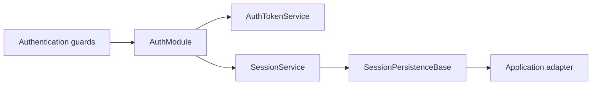

# Platform Authentication

`platform-authentication` provides NestJS authentication mechanics around
application-owned persistence adapters and subject models.

## Persisted Session Activity

`SessionService.isActive()` checks a token against an exclusive activity cutoff.
`SessionService.hasActiveSession()` applies the same rule across a user's
persisted sessions. Archipel supplies these mechanics without choosing an idle
duration, an application error, or the browser events that represent activity.

The optional `LastActiveMiddleware` updates timestamps for every authenticated
HTTP request. Applications requiring strict human-interaction semantics should
disable it and record activity through an explicit application endpoint.

See the
[authentication and authorization guide](../../guides/authentication-and-authorization.md)
for adapters, guards, session lifecycle, inactivity checks, and middleware
configuration.
