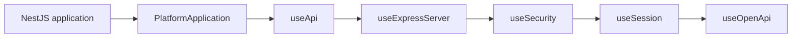

# Platform Bootstrap

`platform-bootstrap` composes common NestJS startup concerns as ordered `use*`
steps while keeping application creation and infrastructure choices visible in
the consuming entrypoint.

## Process Guard

`PlatformProcessGuard.install()` restores fail-fast semantics for fatal errors
and keeps closed standard streams from turning into a logging loop. It is
installed once in the entrypoint, before the application is created, and is
independent of the step pipeline.

| Situation                      | Behavior                                                                  |
| ------------------------------ | ------------------------------------------------------------------------- |
| Uncaught exception             | Reported once, bounded flush of stdout and stderr, exit code 1            |
| Unhandled promise rejection    | Same as an uncaught exception by default; `'log'` keeps the process alive |
| Closed stdout or stderr        | `EPIPE` and `ERR_STREAM_DESTROYED` are ignored; the output is discarded   |
| Other stdout or stderr failure | Fatal                                                                     |
| `terminate(error, origin)`     | Same fatal path for errors the application catches, such as startup       |

See the [application bootstrap guide](../../guides/application-bootstrap.md#fatal-errors-and-broken-output-streams)
for installation and the choice between the rejection modes.

## Session Bootstrap

`useSession()` registers `express-session` from typed Archipel configuration.
Applications can set `rolling: true` to renew the configured cookie maximum age
on every handled response. Rolling remains opt-in and does not define which
requests count as human activity; that policy belongs to the application.

| Configuration key      | Responsibility                |
| ---------------------- | ----------------------------- |
| `AUTH_SESSION_SECRET`  | Session cookie signing secret |
| `AUTH_SESSION_SECURE`  | Secure-cookie enforcement     |
| `AUTH_SESSION_MAX_AGE` | Session cookie maximum age    |

See the [application bootstrap guide](../../guides/application-bootstrap.md)
for composition order, configuration registration, and rolling-session setup.
