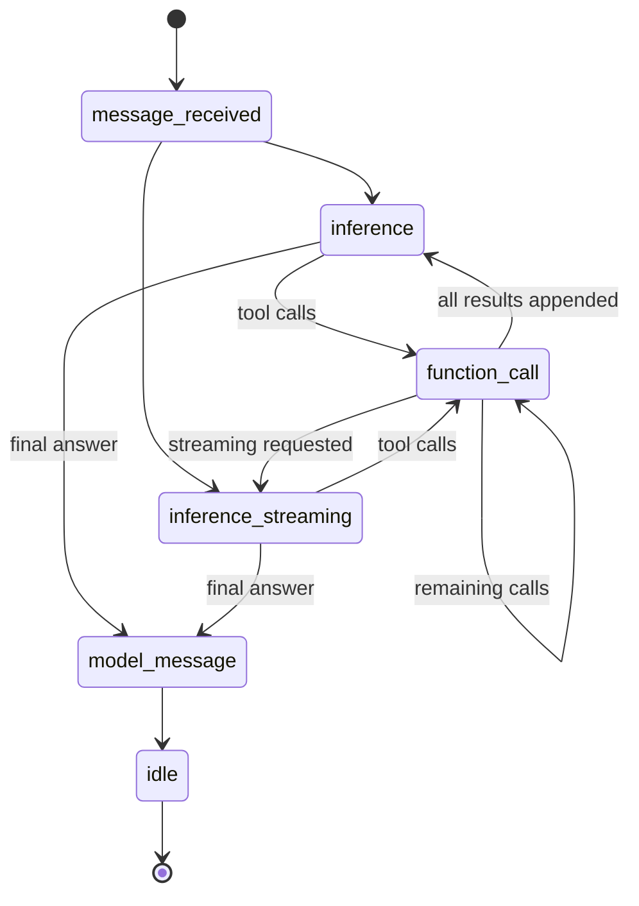

# Intelligence Agents

`@pixel-brewery/archipel-platform-intelligence-agents` provides an application-neutral multi-agent runtime for NestJS. It composes participant coordination, semantic events, situations and bounded agent loops through Archipel abstract bases and adapters. See [the architecture guide](./architecture) for component ownership and [third-party notices](./third-party-notices) for retained license notices.

The package is an **orchestration layer above `platform-intelligence`**. Model selection, credentials, provider adapters, schema validation, retries, usage normalization and provider timeouts remain in that lower library. Existing `IntelligenceAgentFactory` remains the lightweight option for a single bounded model/tool run. This package adds explicitly owned environments containing multiple agents and humans, semantic event reactions and interceptable execution.

## Composition

Your application initializes `ConfigModule.forRoot()` once and configures its usual `IntelligenceModule`. Import that configured module through `AgentsModule`:

```typescript
import { Module } from '@nestjs/common';
import { ConfigModule, EnvironmentConfigStrategy } from '@pixel-brewery/archipel-platform-configuration';
import { IntelligenceModule } from '@pixel-brewery/archipel-platform-intelligence';
import { OPENAI_CONFIG_ENTRIES, OpenAIIntelligenceProviderAdapter } from '@pixel-brewery/archipel-platform-intelligence/provider/openai';
import { AgentsModule } from '@pixel-brewery/archipel-platform-intelligence-agents';

@Module({
    imports: [
        ConfigModule.forRoot({ strategyFactory: () => new EnvironmentConfigStrategy() }),
        AgentsModule.register({
            imports: [
                IntelligenceModule.register({
                    configEntries: OPENAI_CONFIG_ENTRIES,
                    providerAdapters: [OpenAIIntelligenceProviderAdapter],
                    // Select a model supported by your configured provider.
                }),
            ],
        }),
    ],
})
export class ApplicationModule {}
```

Provide your own injectable `AgentInferenceBase` through `AgentsModule.register({ inference: MyInferenceAdapter, imports: [...] })` for another inference infrastructure. A custom adapter implements buffered `run(request)` and `stream(request)` and must honor cancellation. Streams end with exactly one `{ type: 'output', result }` event. Missing default inference dependencies fail NestJS composition instead of silently using vendor credentials.

## Runtime ownership and agents

Inject `AgentRuntimeFactory` and create one explicitly scoped runtime per owner lifetime. Runtime objects contain local state; the factory holds a bounded lifecycle registry, not a global user/tenant context.

```typescript
import { Agent, Human } from '@pixel-brewery/archipel-platform-intelligence-agents';

const runtime = factory.create();
const agent = new Agent({
    id: 'inspector',
    name: 'Inspector',
    instruction: 'Inspect the supplied data. Ask for clarification when needed.',
    capabilities: ['inspection'],
    tools: {
        inspect: {
            inputSchema: {
                kind: 'json-schema',
                jsonSchema: {
                    type: 'object',
                    properties: { reference: { type: 'string' } },
                    required: ['reference'],
                    additionalProperties: false,
                },
            },
            execute: async (input, context) => inspectionService.inspect(input, context.abortSignal),
        },
    },
});
const human = new Human({ id: 'operator', name: 'Operator' });
runtime.join(agent);
runtime.join(human);

try {
    const outcome = await runtime.runLoop(agent.id, 'Inspect reference 123.', {
        generation: {
            requestId: 'operation-123',
            beforeProviderCall: (event) => applicationFence.checkProviderCall(event),
        },
        beforeToolCall: (call, context) => applicationFence.checkToolCall(call, context),
    });
    // outcome contains status, loop identity, final output, conversation and visited phases.
    await runtime.drain();
} finally {
    await runtime.dispose();
}
```

Agent and human manifests are ordinary platform identities. Capabilities are descriptive metadata and do **not** grant authorization. Applications decide which agents are visible, which tools exist, whose authority applies and which records may be read or changed. There are no employee, tenant, task, billing or other product-specific models here.

Joining the same identity twice is idempotent and does not replace the original participant. Leaving removes membership, emits a lifecycle event and cancels that participant's active/paused loops. The factory disposes all its runtimes during NestJS module shutdown. No model call or timer runs merely because a participant is registered. `runtime.diagnostics` exposes current participant, active/paused loop, pending handler and dispatch-failure gauges for consumer metrics.

## Situations and events

Extend `SituationSpecificationBase.isSatisfiedBy(context)` and combine predicates through `.and()`, `.or()` and `.not()`. Each `ISituationHandler` pairs a specification with a `SituationProcessorBase` (a structurally compatible `{ apply(context) }` object also works).

```typescript
import { AgentEvent, SituationSpecificationBase } from '@pixel-brewery/archipel-platform-intelligence-agents';
import type { ISituationContext } from '@pixel-brewery/archipel-platform-intelligence-agents';

class InspectionRequested extends SituationSpecificationBase {
    public override isSatisfiedBy(context: ISituationContext): boolean {
        return context.event.type === 'inspection.requested';
    }
}
agent.setHandlers([
    {
        specification: new InspectionRequested(),
        processor: {
            apply: async (context) => {
                await runtime.runLoop(context.participant.id, 'Inspect the requested data.');
            },
        },
    },
]);
runtime.sendEvent(new AgentEvent('inspection.requested', human.id, { reference: '123' }));
await runtime.drain();
```

`sendMessage(message, senderId)` produces `message.sent`. Custom events require a registered `producerId`. Events fan out to membership and handler snapshots taken at publication. All predicates/processors are scheduled independently, so synchronous throws and rejected asynchronous reactions cannot prevent another participant from receiving an event. `drain()` waits for these reactions and nested publications; failures are logged without payloads and surfaced as `EVENT_DISPATCH_FAILED`. Do not call `drain()` inside a handler, because it would wait for itself.

Events include `type`, `producerId`, `occurredAt`, `payload` and optional `loopId`. The runtime emits:

- `participant.joined`, `participant.left`, `message.sent` and arbitrary application event types.
- `message_received.started`, `message_received.completed`.
- `inference.started`, `inference.stream`, `inference.completed` (including normalized per-call usage).
- `function_call.started`, `function_call.completed`, `function_call.rejected`, `function_call.failed`.
- `model.answer`, `interception.started`, `interception.finished`.
- `loop.paused`, `loop.stopped`, `loop.completed`, `loop.failed`, `stream.cleanup_failed`.

Supply an `AgentEventSinkBase` through `factory.create({ eventSink })` for your audit/telemetry adapter. It shares the bounded non-blocking dispatch mechanism. This is **not a transactional durable audit outbox**: an application requiring guaranteed audit delivery must implement durable recording and fencing in its owning command/guard before an effect. Event payloads may contain prompts, tool arguments, results and model output; the consumer owns redaction, authorization, retention and distributed delivery. No event is exported to a vendor cloud automatically.

## Loop contract



Each run forks memory. Multiple runs may execute concurrently, including on the same agent; their messages/tool results are isolated. A completed run appends only its own conversation to the agent's current memory atomically. Completion order determines merged conversation order. Failed, stopped or paused runs do not commit unfinished context. All tool calls in a provider response execute once in response order and retain their call identifiers. Duplicate or reused call identifiers within a run fail before a repeated effect. A failed/unknown/schema-invalid tool produces a sanitized error result so the model can correct its request. Effects are never automatically retried by the agent runtime.

Before provider dispatch, `IntelligenceInferenceAdapter` strips executable tools, disables global registry inclusion and forces `maxSteps: 1`. The runtime owns tool effects so interception and application permission checks occur before each effect. Provider-native executable tools cannot bypass this boundary; use application tools or a separately owned inference implementation.

`streaming: true` forwards the existing normalized intelligence stream and produces the same final result/loop routing as buffered generation. `schema` delegates structured output to the lower intelligence library. When a run has tools and a schema, it first completes its ordinary tool conversation, then performs one extra **tool-free constrained formatting call**. Structured streaming emits `partial-output` events in that final call. Provider guards and usage events apply to that additional call too. Tools must fit the configured Archipel model/provider capabilities; this package maintains no separate vendor model catalog.

`AgentInterceptionBase` can inspect/rewrite a typed `AgentTransition` before execution, pause it or stop it. Paused outcomes include the `loopId`; `resumeLoop(loopId)` re-evaluates interception and tool guards. `cancelLoop(loopId)` cancels/discards the run. A tool with `needsApproval: true` fails closed unless the application's `approveToolCall(call, context)` grants that specific execution. A model's claim of approval has no effect. Application guards should resolve current authority at dispatch time, including after a pause.

## Memory, cancellation and persistence

`ModelContext.record()` and `new ModelContext(record)` round-trip provider-neutral conversation messages. `fork()` creates isolated state; snapshots are defensive copies. Memory rejects overflow atomically rather than evicting individual messages and orphaning tool call/result pairs. Applications can persist records and reconstruct agents. The runtime, handlers, tools and paused continuations themselves are process-local objects and are **not** serialized by this package.

An application agent hub can persist registrations, tool-catalog references, triggers, schedules, run claims, operation idempotency keys and memory in its own storage, then materialize an explicitly owned runtime on a worker. Use a distributed lease/fence to prevent two workers executing the same business operation. Neither local registration nor a paused outcome is a claim of durable recovery or exactly-once execution. Application-specific persistence, scheduling and HTTP controllers belong to consumers; no listening port, route, database schema or scheduler is installed.

Cancellation combines the caller's signal and the runtime controller; run timeout covers an active run/resume invocation. Interception, inference, schema validation and tools are awaited under that signal. An adapter that ignores cancellation cannot keep the caller waiting past the budget. **Cancellation cannot undo an external effect** and does not forcibly terminate uncooperative application code. Tools must honor the supplied signal and use consumer-owned idempotency/fencing at their authoritative write boundary. Preserve partially executed operation evidence in the consumer's ledger before retrying.

| Resource                            |    Default | Policy                                                             |
| ----------------------------------- | ---------: | ------------------------------------------------------------------ |
| Live runtimes per factory           |        128 | Reject additional creation; disposal releases capacity             |
| Participants per runtime state      |        256 | Configurable; reject overflow                                      |
| Tools per agent (`maxTools`)        |        128 | Configurable; reject overflow                                      |
| Handlers per participant            |        128 | Reject overflow                                                    |
| Active and paused loops per runtime |         32 | Configurable; cancel/complete releases capacity                    |
| Pending handler/sink jobs           |       1024 | Configurable; fail publication on overload; no silent queue growth |
| Conversation messages               |        512 | Configurable; reject the whole append                              |
| State executions per run            |         64 | Configurable up to 4096, retained across pause/resume              |
| Run timeout                         | 30 seconds | Configurable up to one hour per active invocation                  |
| Drain / runtime shutdown            |  5 seconds | Configurable up to 10 seconds, then fail explicitly                |

## MCP tools

MCP transport belongs to `@pixel-brewery/archipel-platform-mcp/client`. The agents package's optional `/mcp` entry point contains only `McpToolAdapter`, which translates that shared client's tools into existing intelligence tool definitions. Install the optional `platform-mcp` peer when using this adapter. The core agents entry point does not import the MCP client or SDK.

```typescript
import { McpClient, McpClientHealthIndicator } from '@pixel-brewery/archipel-platform-mcp/client';
import { McpToolAdapter } from '@pixel-brewery/archipel-platform-intelligence-agents/mcp';

const client = new McpClient({ url: configuredServerUrl, authToken: configuredToken });
const adapter = new McpToolAdapter([client]);
healthOrchestrator.registerIndicator(new McpClientHealthIndicator(client, 'inspection-mcp'));
try {
    const tools = await adapter.discoverTools();
    const agent = new Agent({ name: 'Remote inspector', instruction: 'Inspect data.', tools });
    // Join the agent to its explicitly owned runtime and dispatch work.
} finally {
    await adapter.close();
}
```

The existing `@McpTool` decorator, `McpRegistryService` and `McpServerService` remain the server registration pipeline. The server exposes its Zod metadata as the standard MCP `Tool` JSON-schema contract, which the shared client discovers without a second tool-specification model. The adapter preserves input and output schemas, returns structured content when available, joins text-only results, and preserves complete protocol results containing other content blocks. Server annotations remain descriptive hints; application approval and authorization guards remain authoritative.

The adapter owns up to 16 supplied clients and a bounded projection of at most 128 tools. Concurrent discovery shares one promise; cross-server name collisions fail explicitly. It closes every supplied client, including clients whose discovery failed. For transport configuration, complete result contracts, readiness and cleanup budgets, see the [MCP client guide](../platform-mcp/#client-connections). Connections and credentials are resolved through the consumer's typed configuration and stay scoped to their owner. Tool effects are never retried automatically.

## Validation

Run `yarn nx run platform-intelligence-agents:test` (real Vitest CLI via an Nx target), `:typecheck`, `:typecheck-tests`, `:lint`, `:build` and `:docs`. Tests include a real NestJS/IntelligenceModule/AI SDK provider-boundary journey and a real local Streamable HTTP MCP server. Provider models are deterministic test implementations; verification does not spend tokens on a live provider. API documentation is generated under `.docs/packages/platform-intelligence-agents/api`.
