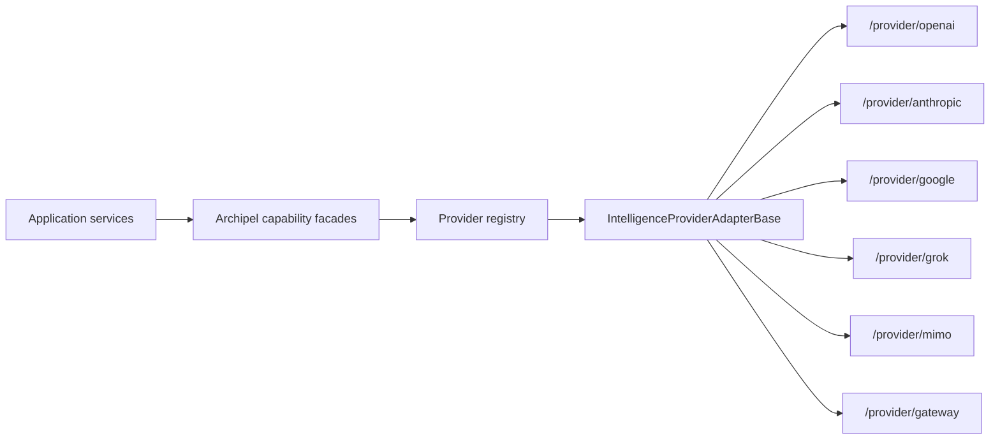

# Platform Intelligence

Applications depend on Archipel capability facades and register only the
provider subpaths they use. Provider SDKs, ESM loading, model construction,
timeouts, retries, and error normalization stay inside the package.

## Providers

| Provider          | Import subpath        | Configuration entries       |
| ----------------- | --------------------- | --------------------------- |
| OpenAI            | `/provider/openai`    | `OPENAI_CONFIG_ENTRIES`     |
| Anthropic         | `/provider/anthropic` | `ANTHROPIC_CONFIG_ENTRIES`  |
| Google            | `/provider/google`    | `GOOGLE_CONFIG_ENTRIES`     |
| xAI / Grok        | `/provider/grok`      | `GROK_CONFIG_ENTRIES`       |
| Xiaomi MiMo       | `/provider/mimo`      | `MIMO_CONFIG_ENTRIES`       |
| Vercel AI Gateway | `/provider/gateway`   | `AI_GATEWAY_CONFIG_ENTRIES` |

OpenAI, Anthropic, Google, Grok, and MiMo also expose provider-owned tools from
their `/tools` subpaths. Provider-specific environment keys are exported only
from the corresponding provider entrypoint; the package root stays
provider-neutral. Provider entrypoints do not re-export tool factories, so
provider tools remain a separate opt-in runtime boundary.

Every selected entrypoint lazily loads its own optional runtime package through
a static native ESM `import()`. The provider-neutral `ai` runtime is imported
directly at its usage sites and relies on Node's ESM module cache instead of a
shared loader. Serverless packagers can therefore trace the selected provider
SDK and the provider-neutral AI runtime without forcing unrelated provider SDKs
into the function artifact. No CommonJS bridge or `require.resolve()`
indirection remains in the intelligence package.

The standard package test target first runs the Nx package build and then the
provider-entrypoint and generator-topology contract tests. The build compiles
every declared subpath, while the tests keep package exports, TypeScript paths,
provider-local barrels, optional provider dependencies, and the
provider-neutral root surface synchronized. They also require direct static
runtime traces for the provider-neutral AI runtime and every provider-local
loader.

## Capability Surface

| Surface                              | Responsibility                                                                            |
| ------------------------------------ | ----------------------------------------------------------------------------------------- |
| `IntelligenceLanguageGenerator`      | Text, structured output, streams, and tools                                               |
| `IntelligenceEmbeddingGenerator`     | Single and batch embeddings                                                               |
| `IntelligenceImageGenerator`         | Image generation and editing                                                              |
| `IntelligenceSpeechGenerator`        | Text-to-speech generation                                                                 |
| `IntelligenceTranscriptionGenerator` | Bounded and live transcription                                                            |
| `IntelligenceVideoGenerator`         | Text/image-to-video generation                                                            |
| `IntelligenceReranker`               | Provider-neutral semantic ranking                                                         |
| `IntelligenceRealtimeSessionFactory` | Server-owned audio/text sessions; browser WebRTC setup and server-side WebRTC termination |
| `IntelligenceAgentFactory`           | Bounded reusable tool-loop agents                                                         |
| `IntelligenceProviderAssetUploader`  | Provider files and skills                                                                 |
| `IntelligenceProviderDiagnostics`    | Bounded provider/model probes                                                             |

Browser-owned WebRTC sessions keep running at the provider while the browser's
peer connection stays open. `terminateWebRTCSession()` ends them idempotently
with server credentials when an application lease expires, the browser closes
its connection, or the logical session completes. Providers that report the
final billable duration only while closing a session, such as OpenAI GPT-Live,
return it as `durationSeconds`; see the
[realtime voice guide](../../guides/ai-realtime-voice.md#ending-browser-owned-sessions).

A new WebRTC session that continues an earlier conversation, for example after
a pause, a dropped connection, or a page reload, can receive its most recent
turns through `conversationHistory`. Archipel validates them against
`IntelligenceRealtimeConversationHistoryLimits`, hands them to the provider as
one quoted, untrusted context block that does not make the model respond, and
reports `handed-over` or `unsupported`; see
[continuing a conversation](../../guides/ai-realtime-voice.md#continuing-a-conversation-on-a-new-connection).

## Tool Selection Boundaries

Language calls include the global `IntelligenceToolRegistry` by default and
merge call-local tools over it. `includeRegisteredTools: false` creates an
isolated call-local tool boundary. If `activeToolNames` is present, Archipel
passes only those named tools to the AI SDK and rejects duplicate or unavailable
names with `IntelligenceValidationError` before a provider request. This keeps
the SDK-visible tool surface aligned with the application's policy decision
instead of relying only on the provider's active-tool hint.

`deferredToolLoading` is the on-demand alternative for large catalogs. The AI
SDK receives every composed tool plus a built-in loader tool (`load_tools` by
default), while the SDK's per-step `activeTools` selection exposes only the
loader, the optional `initialToolNames`, and the tools loaded earlier in the
same call. The loader's description lists every inactive tool with a
one-sentence summary; inactive tools cannot execute, activation state never
leaves its call, and loader executions are reported through the regular tool
execution events. It cannot be combined with `activeToolNames` and requires
`maxSteps` of at least 2; see the
[AI language generation guide](../../guides/ai-text-generation.md#deferred-tool-loading)
for the complete contract.

The registry capacity is bounded to 128 definitions by default and can be
raised explicitly with `IntelligenceModule.register({ maxTools })` for
applications that own a larger operation catalog. Registry capacity and model
exposure are independent: a larger registry still requires a deliberately
small, authorized `activeToolNames` subset or `deferredToolLoading` for each
provider request.

Applications that persist or defer model-produced tool input can call
`validateIntelligenceSchema()` against the tool's provider-neutral input
schema first. Plain JSON schemas are compiled and cached centrally, while
explicit validators and Standard Schema implementations keep their own
normalization behavior.

## Prepared Calls and Durable Dispatch

`IntelligenceLanguageGenerator.prepareText()` performs local model resolution,
option validation, prompt snapshotting, tool selection, schema conversion, and
the AI SDK's standardization pipeline against a synthetic terminal response.
It contacts no provider and returns a single-use call plus an immutable snapshot
of the exact standardized initial provider input for early reservation decisions.

`beforeProviderCall` is an awaited enforcement boundary on the standardized AI
SDK request. It runs immediately before every native generate or stream attempt,
reports the current standardized context size and output/tool facts, and aborts
dispatch when it rejects. Applications should place durable capacity and
idempotency fences there and treat `onStepStart` as telemetry only.

## Normalized Usage

Capability results use `IIntelligenceUsage` to transport provider-reported
input, output, total, cache-read, cache-write, reasoning, and text/image/audio
modality counters. Missing counters are `null`, not zero. Image generation
reconciles the normalized result with provider metadata so text input, image
input, and generated image output remain separately accountable when the
provider exposes them.

Language results and streams that needed several provider calls, such as tool
loops, also expose `stepUsage` with the usage of each call in execution order;
`usage` is its sum. Providers that price every request on its own, for example
with long-context rates above an input-token threshold, must be priced per
entry.

Archipel deliberately does not assign monetary prices or application billing
units. Consumers persist and price the normalized usage according to their own
provider, model, currency, entitlement, and audit policies.

OpenAI video uses an internal asynchronous create/poll/download bridge because
the OpenAI AI SDK provider does not expose a video-model handle. The bridge is
owned by `/provider/openai`; applications continue to use the provider-neutral
`IntelligenceVideoGenerator` contract. The current OpenAI Videos API and Sora
2 models are scheduled to shut down on September 24, 2026, so their eventual
replacement remains isolated to that provider entry point.

See the [package README](https://github.com/pixel-brewery/archipel/tree/main/libs/platform-intelligence)
for registration and migration examples and the generated API pages for
contract details.
