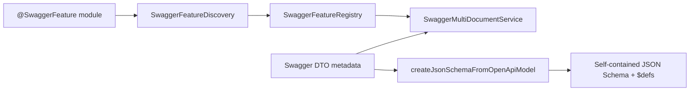

# Platform OpenAPI

`platform-openapi` owns OpenAPI discovery, feature-specific documents, Swagger
UI setup, and reusable DTO contract generation for NestJS applications.
The JSON Schema API requires `@nestjs/swagger` 11.3 or newer.

## Feature Documents

Each `@SwaggerFeature` declaration owns a title, path, tags, and optional
`extraModels`. The multi-document service passes those models to NestJS Swagger
and retains their recursively referenced components even when no controller
operation uses them. The default `all` document receives the deduplicated model
union from every registered feature.

Operations continue to use the `@Api` decorator for tags, authentication,
parameters, bodies, responses, callbacks, and endpoint-local extra models.
Feature filtering keeps operations matching any configured feature tag and
prunes schemas that are neither operation-referenced nor feature-owned.

## JSON Schema Contracts

`createJsonSchemaFromOpenApiModel()` converts the same NestJS Swagger DTO graph
into a self-contained JSON Schema. It supports Swagger mapped types and custom
`@ApiSchema` names, rewrites reachable component references to `$defs`, and
normalizes OpenAPI `nullable` flags into JSON Schema null unions. Missing
components and conflicting model or enum schema names fail immediately.

Pass `{ additionalProperties: false }` to close generated object schemas that
do not already define an additional-properties policy. The result stays
provider-neutral; consumers decide how to validate or transport it.

See the [OpenAPI and feature discovery guide](../../guides/openapi-and-feature-discovery.md)
for setup, route layout, mapped DTO examples, filtering rules, and spec export.
