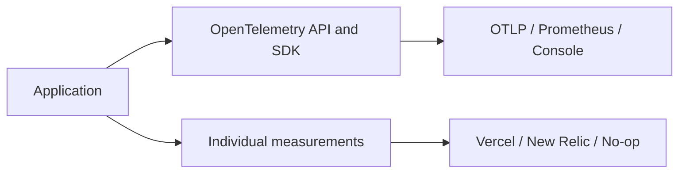

# Platform Telemetry

The root and `/otel` entry points own OpenTelemetry tracing, metrics, aggregation, and export. Metric readers for OTLP/HTTP, OTLP/gRPC, Prometheus scraping, and console diagnostics are separate `/otel/providers/*` entry points.

The `/measurements` entry point records individual numeric values without an OpenTelemetry instrument type. Its optional `/measurements/providers/vercel` , `/measurements/providers/new-relic`, and `/measurements/providers/empty` sinks are separate build entry points. The Vercel dependency is loaded only when that provider is imported.

See the [telemetry and observability guide](/guides/telemetry-and-observability) for registration, recording, and the distinction between aggregated OpenTelemetry metrics and Vercel data points. The [API reference](/packages/platform-telemetry/api/) lists public types and classes.

`MeasurementsModule.register({ diagnostics })` optionally provides `DiagnosticsService` for safe dependency and task outcomes. The New Relic provider uses explicit EU/US routing and host-owned resource attributes; PostgreSQL pool observation and safe database failure classification belong to `platform-database/postgres`. See the guide for configuration, bounded delivery, request correlation, and failure contracts.
