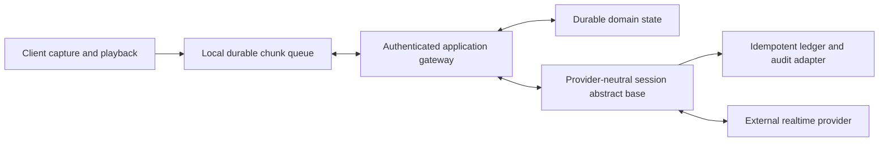
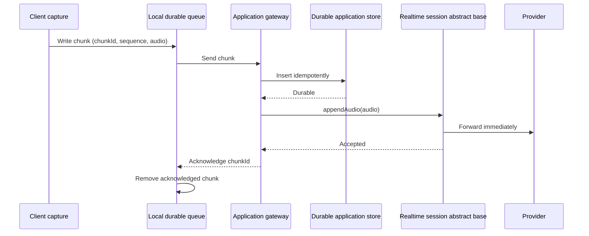
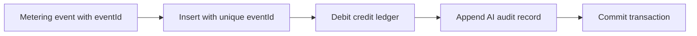
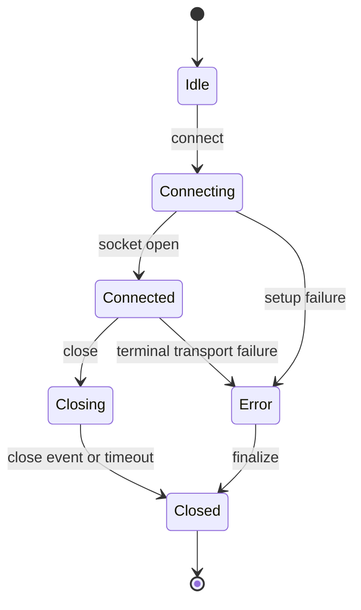

# Archipel Realtime Session Pattern

## Overview

A realtime session is a long-lived, bidirectional connection to an external
provider. Unlike a normal request, it can outlive access-token refreshes,
client network changes, deployments, and individual HTTP transactions. Its
correctness therefore depends on explicit ownership, durable checkpoints,
bounded queues, idempotent accounting, and visible reconnects.

`platform-intelligence` applies this pattern to live AI audio and text through
`IntelligenceRealtimeSessionFactory` and
`IntelligenceRealtimeSessionBase`. The same rules apply to other long-lived
provider streams.

---

## Canonical Topology

The platform library owns the upstream provider connection. The application
owns the client-facing transport and all business state. The client owns media
capture and the last local copy of data not yet acknowledged by the
application.

---

## Invariant 1: Separate Logical and Physical Identity

Never use one identifier for both the durable conversation and a provider
socket.

| Identity           | Changes on reconnect | Used for                                                           |
| ------------------ | -------------------- | ------------------------------------------------------------------ |
| Logical session ID | No                   | Authorization, domain persistence, customer-visible history        |
| Connection ID      | Yes                  | Provider attempt, metering idempotency, diagnostics, close history |

One logical session may have many sequential provider connections. Every
connection start and end must remain visible in the audit trail.

In `platform-intelligence`, these identities are `sessionId` and
`connectionId`.

---

## Invariant 2: One Owner Per Active Connection

An upstream WebSocket and its event queues live in one process. All commands
for that connection must reach the owning process and execute in order.

Acceptable cluster strategies include:

- sticky client routing for the active gateway connection;
- a distributed ownership record mapping connection ID to pod;
- a dedicated realtime worker selected before the client begins streaming.

The in-memory factory registry is a process-local lifecycle mechanism, not a
distributed session store. Durable business state must never depend on it.

---

## Invariant 3: Persist Small Units While Streaming

Durability must not turn realtime media into a deferred upload. Split the
stream into small ordered fragments and persist each fragment before it is
acknowledged.

The local write protects against a browser or network failure. The application
write protects against gateway restarts and provides the source for recovery.
The provider call remains live because this happens per fragment rather than
after the complete recording.

### Chunk-envelope rules

- The application envelope contains a stable `chunkId` and monotonic
  `sequence`.
- Persistence uses `(logicalSessionId, chunkId)` as an idempotency key.
- The durable record distinguishes `pending` from `forwarded`. A duplicate of
  a forwarded chunk is acknowledged without another upstream write; a pending
  chunk still needs forwarding.
- Gaps stop acknowledgement until the application's ordering policy resolves
  them.
- The provider-neutral abstract base receives only the media payload required by the
  upstream contract.
- Chunk size, capture cadence, and audio format are negotiated by the
  application and selected provider.

There is an unavoidable ambiguity if a process dies after the provider accepts
a fragment but before the application marks it forwarded. Most realtime
provider audio-append operations have no application idempotency key. Do not
claim exactly-once provider delivery; retain the durable recording and make
connection recovery explicit instead.

---

## Invariant 4: Preserve Wire Order, Bound Every Queue

Inbound provider events and outbound client commands must be serialized per
connection. Concurrent callbacks may otherwise reorder transcript deltas,
tool calls, response cancellation, or audio commits.

Every queue also needs a finite capacity:

| Queue or buffer               | Overflow policy                                                       |
| ----------------------------- | --------------------------------------------------------------------- |
| Client local queue            | Stop capture or warn before storage exhaustion                        |
| Client-to-application frames  | Apply socket backpressure and stop acknowledgement                    |
| Application persistence queue | Reject or pause the client; never grow without limit                  |
| Provider outbound queue       | Fail the command with a retryability signal                           |
| Provider inbound queue        | Close the connection when ordering can no longer be guaranteed        |
| Metering queue                | Close or degrade according to the application's billing safety policy |
| WebSocket buffered bytes      | Reject additional writes until the socket drains                      |

`platform-intelligence` serializes provider events and enforces per-session
event and byte limits. These limits do not replace tenant quotas or client
gateway limits.

---

## Invariant 5: Meter Through an Idempotent Application Base

Long-lived streams cannot rely on request interceptors for complete usage
accounting. Emit durable lifecycle and interval events through an application
abstract base instead.

Each event must contain:

- a stable event ID;
- logical session and physical connection IDs;
- provider and model;
- occurrence time;
- bounded correlation metadata;
- event-specific interval, usage, or close data.

The adapter uses the event ID as a unique key and commits the usage event,
commercial ledger change, and AI audit record in one transaction.

Use provider-independent intervals for predictable commercial charging and
provider-reported token dimensions for reconciliation. Do not charge both
sources for the same work unless that is an explicit pricing rule.

The adapter should normally write to a local database transaction or outbox.
Calling a slow remote billing API directly increases queue pressure and makes
shutdown flushes unreliable.

---

## Invariant 6: Reconnect Is a New Connection

Do not silently reconnect a stateful provider session. A replacement socket
does not necessarily contain the same model conversation, input buffer, tool
state, or response state.

Recovery creates a new connection:

1. finalize and audit the failed connection;
2. keep the same logical session ID;
3. derive safe context from durable transcript and domain state;
4. create a replacement abstract base with a new connection ID;
5. record the recovery relationship explicitly;
6. resume only unacknowledged application fragments according to provider
   semantics.

Never claim lossless replay when the provider-neutral contract cannot restore
provider-native conversation state.

---

## Invariant 7: Keep Provider Secrets and Contracts Upstream

The client must not receive permanent provider API keys. The application
gateway speaks an application-owned protocol; the platform adapter speaks the
provider protocol.

For realtime intelligence:

- provider-specific model creation and wire mapping go through Vercel AI SDK
  provider packages;
- Archipel exposes normalized client and server event unions;
- a generic server WebSocket carries the provider configuration returned by
  the AI SDK adapter;
- provider-native events remain available only as an audited `raw` escape
  hatch.

This boundary allows the application to switch providers without rewriting
authentication, persistence, metering, or the client transport.

---

## Invariant 8: Shutdown Is Part of Correctness

The owner of a long-lived connection must implement deterministic teardown:

1. reject or stop accepting new client input;
2. clear periodic timers;
3. close the upstream socket with a bounded timeout;
4. emit the final partial billing interval;
5. emit the connection-end event;
6. flush queued metering within the shutdown budget;
7. release the process-local ownership record.

The Nest application must enable shutdown hooks for `OnModuleDestroy` to run
on process signals.

---

## Failure Policy

| Failure                           | Retry in place?     | Required action                                          |
| --------------------------------- | ------------------- | -------------------------------------------------------- |
| Transient provider token creation | Yes, bounded        | Retry with backoff before socket creation                |
| Socket open timeout               | No hidden reconnect | Fail connection attempt and report retryability          |
| Outbound command failure          | Caller decides      | Keep client data unacknowledged when safe to retry       |
| Malformed provider event          | No                  | Report receive error; close if ordering is unsafe        |
| Queue or byte limit exceeded      | No                  | Apply backpressure or close with explicit reason         |
| Metering adapter failure          | Bounded retry       | Persist through a durable local adapter; surface failure |
| Provider disconnect               | No hidden reconnect | Finalize connection and start explicit recovery          |
| Process shutdown                  | No                  | Drain and close within the configured timeout            |

---

## Checklist

- Logical session and physical connection IDs are distinct.
- Exactly one process owns an active upstream connection.
- The client keeps unacknowledged fragments durably.
- The application persists fragments idempotently before acknowledgement.
- Streaming continues per fragment; there is no whole-session upload gate.
- Provider commands and events preserve per-connection order.
- Every queue, collection, timer, and byte buffer is bounded.
- Metering events have stable idempotency keys.
- Ledger debit and AI audit persistence share one transaction.
- Provider token data never reaches the client-facing protocol.
- Reconnect creates a visible new connection.
- Recovery claims only the context the provider contract can reconstruct.
- Shutdown closes sockets and flushes final metering.

See [AI Realtime Voice](../guides/ai-realtime-voice) for the concrete
`platform-intelligence` integration.
