# Archipel Project Conventions

This document describes the **project-specific** conventions for the Archipel NestJS monorepo. It complements the general coding standards and ensures consistency when adding, modifying, or removing platform libraries and providers.

---

## Table of Contents

- [Workspace Layout](#workspace-layout)
- [Platform Library Structure](#platform-library-structure)
- [Multi-Entry-Point / Subpath Export Pattern](#multi-entry-point--subpath-export-pattern)
- [Adding a New Provider to a Library](#adding-a-new-provider-to-a-library)
- [Removing a Provider from a Library](#removing-a-provider-from-a-library)
- [Documentation Rules](#documentation-rules)
- [Build, Test & Tooling](#build-test--tooling)
- [Configuration Pattern](#configuration-pattern)
- [Module Registration Pattern](#module-registration-pattern)
- [Abstract Base / Adapter Architecture](#abstract-base--adapter-architecture)
- [Checklist: Provider Lifecycle](#checklist-provider-lifecycle)

---

## Workspace Layout

```mermaid
flowchart TB
  Archipel[archipel/]
  Libs[libs/]
  Apps[apps/]
  Tools[tools/]
  Infra[infra/]
  Docs[.docs/]
  TsconfigBase[tsconfig.base.json]
  NxJson[nx.json]
  RootPackageJson[package.json]

  Archipel --> Libs
  Archipel --> Apps
  Archipel --> Tools
  Archipel --> Infra
  Archipel --> Docs
  Archipel --> TsconfigBase
  Archipel --> NxJson
  Archipel --> RootPackageJson

  Libs --> PlatformCore[platform-core]
  Libs --> PlatformConfiguration[platform-configuration]
  Libs --> PlatformDatabase[platform-database]
  Libs --> PlatformCaching[platform-caching]
  Libs --> PlatformCryptography[platform-cryptography]
  Libs --> PlatformBlobStorage[platform-blob-storage]
  Libs --> PlatformDocuments[platform-documents]
  Libs --> PlatformAuthentication[platform-authentication]
  Libs --> PlatformHealth[platform-health]
  Libs --> PlatformMailing[platform-mailing]
  Libs --> PlatformMapping[platform-mapping]
  Libs --> PlatformPayments[platform-payments]
  Libs --> PlatformEsigning[platform-esigning]
  Libs --> PlatformIntelligence[platform-intelligence]
  Libs --> PlatformAnalytics[platform-analytics]
  Libs --> PlatformQueue[platform-queue]
  Libs --> PlatformReporting[platform-reporting]
  Libs --> PlatformResources[platform-resources]
  Libs --> PlatformOpenApi[platform-openapi]
  Libs --> PlatformTelemetry[platform-telemetry]
  Libs --> PlatformLogging[platform-logging]
  Libs --> PlatformMcp[platform-mcp]

  Apps --> FrontendDocs[frontend/docs]
  Tools --> ToolMcp[mcp]
  Tools --> PrismaEntities[prisma-generator-entities]
  Tools --> PrismaJsonSchema[prisma-generator-json-schema]
  Infra --> NxPlugins[nx-plugins]
  Docs --> DocsPackages[packages]
  Docs --> DocsGuides[guides]
  Docs --> DocsArchitecture[architecture]
  Docs --> DocsTools[tools]
```



### Key Rules

- **`libs/`** contains only platform libraries. No feature/business code.
- **`platform-core`** has zero Archipel dependencies - everything else may depend on it.
- **No horizontal dependencies** between libraries at the same layer.
- **Dependencies flow downward** - higher-layer libraries depend only on lower layers and core.

---

## Platform Library Structure

Every platform library follows this structure:

```mermaid
flowchart TB
  Library[libs/platform-{name}/]
  PackageJson[package.json]
  ProjectJson[project.json]
  TsconfigJson[tsconfig.json]
  TsconfigLibJson[tsconfig.lib.json]
  VitestConfig[vitest.config.mjs]
  Readme[README.md]
  Changelog[CHANGELOG.md]
  Src[src/]

  Library --> PackageJson
  Library --> ProjectJson
  Library --> TsconfigJson
  Library --> TsconfigLibJson
  Library --> VitestConfig
  Library --> Readme
  Library --> Changelog
  Library --> Src

  Src --> IndexTs[index.ts]
  Src --> ModuleTs[{Name}Module.ts]
  Src --> EnvTs[env.ts]
  Src --> Contracts[contracts/]
  Src --> Models[models/]
  Src --> Errors[errors/]
  Src --> Services[services/]
  Src --> Providers[providers/]
  Src --> Guards[guards/]
  Src --> Interceptors[interceptors/]
  Src --> ProviderSubpath[{provider}/]

  ProviderSubpath --> ProviderIndex[index.ts]
  ProviderSubpath --> ProviderEnv[env.ts]
  ProviderSubpath --> ProviderClient[{Provider}Client.ts]
```

---

## Multi-Entry-Point / Subpath Export Pattern

Libraries with multiple providers (payments, esigning, mailing, analytics, etc.) use **subpath exports**. Each provider is a separate entry point that consumers import independently.

### Example: `platform-payments`

```
@pixel-brewery/archipel-platform-payments          → src/index.ts
@pixel-brewery/archipel-platform-payments/stripe    → src/stripe/index.ts
@pixel-brewery/archipel-platform-payments/paddle    → src/paddle/index.ts
@pixel-brewery/archipel-platform-payments/mollie    → src/mollie/index.ts
```

### Files That Must Be Updated for Every Subpath

When adding or removing a provider subpath, **all** of the following must be updated in sync:

| File                                           | What to Update                                                                                                |
| ---------------------------------------------- | ------------------------------------------------------------------------------------------------------------- |
| `libs/platform-{name}/src/{provider}/`         | Source directory (add or remove)                                                                              |
| `libs/platform-{name}/src/{provider}/index.ts` | Barrel export for the subpath                                                                                 |
| `libs/platform-{name}/package.json`            | `typesVersions`, `exports`, `keywords`, `peerDependencies`, `peerDependenciesMeta`, `description`, `archipel` |
| `libs/platform-{name}/project.json`            | `additionalEntryPoints` array in the build target                                                             |
| `tsconfig.base.json`                           | Path mapping under `compilerOptions.paths`                                                                    |
| `package.json` (root)                          | Root dev dependency for the provider SDK                                                                      |
| `libs/platform-{name}/README.md`               | Provider list, environment variables, import examples                                                         |

### package.json Archipel Metadata (Required)

Every library's `package.json` **must** include an `archipel` namespace for documentation metadata. This data is read at build time by the docs site - **no static arrays** are maintained in frontend code.

```jsonc
{
    "name": "@pixel-brewery/archipel-platform-{name}",
    "description": "Brief description of the library.",
    "keywords": ["nestjs", "relevant", "keywords"],
    "archipel": {
        "category": "Foundation | Infrastructure | Identity & Access | Operations | AI & Extensibility",
        "featured": true, // Optional - set to true for important packages
    },
}
```

**Categories:**

- **Foundation**: Core building blocks (core, bootstrap, configuration, cryptography, database, mapping)
- **Infrastructure**: Storage, caching, signing, messaging, queues, documents (blob-storage, caching, esigning, mailing, documents, queue, resources)
- **Identity & Access**: Authentication, payments, feature flags
- **Operations**: Health, OpenAPI, logging, telemetry, analytics, reporting, MCP
- **AI & Extensibility**: Intelligence and AI services

### package.json Anatomy for Multi-Entry-Point Libraries

```jsonc
{
    "name": "@pixel-brewery/archipel-platform-{name}",
    "typesVersions": {
        "*": {
            "{provider}": ["./src/{provider}/index.d.ts"],
        },
    },
    "exports": {
        ".": { "types": "./src/index.d.ts", "default": "./src/index.js" },
        "./{provider}": { "types": "./src/{provider}/index.d.ts", "default": "./src/{provider}/index.js" },
    },
    "peerDependencies": {
        "{provider-sdk}": ">=X.0.0",
    },
    "peerDependenciesMeta": {
        "{provider-sdk}": { "optional": true },
    },
}
```

### tsconfig.base.json Path Mapping

Every subpath export needs a corresponding path mapping in `tsconfig.base.json`:

```jsonc
{
    "compilerOptions": {
        "paths": {
            "@pixel-brewery/archipel-platform-{name}/{provider}": ["libs/platform-{name}/src/{provider}/index.ts"],
        },
    },
}
```

### project.json Additional Entry Points

```jsonc
{
    "targets": {
        "build": {
            "options": {
                "additionalEntryPoints": ["libs/platform-{name}/src/{provider}/index.ts"],
            },
        },
    },
}
```

---

## Adding a New Provider to a Library

Follow this order:

1. **Create the provider directory** with `index.ts`, `env.ts`, and the client implementation.
2. **Update `package.json`**: Add to `typesVersions`, `exports`, `keywords`, `peerDependencies`, `peerDependenciesMeta`.
3. **Update `project.json`**: Add the entry point to `additionalEntryPoints`.
4. **Update `tsconfig.base.json`**: Add the path mapping.
5. **Update root `package.json`**: Add the provider SDK as a dev dependency.
6. **Update `README.md`**: Add the provider to the provider list, environment variables table, and import examples.
7. **Update `.docs/packages/platform-{name}/index.md`**: Add the provider section with config table and mermaid diagram node.
8. **Update `.docs/guides/{name}-*.md`**: Add the provider to the provider table.
9. **Update `.docs/architecture/index.md`**: Update the strategy pattern list if it mentions this library.
10. **Run `yarn install`** to resolve the new SDK.
11. **Run `yarn run build`** to verify compilation.
12. **Run docs target** (`npx nx run platform-{name}:docs`) to regenerate API docs.

---

## Removing a Provider from a Library

Follow this order (reverse of adding):

1. **Delete the provider source directory** (`libs/platform-{name}/src/{provider}/`).
2. **Update `package.json`**: Remove from `typesVersions`, `exports`, `keywords`, `peerDependencies`, `peerDependenciesMeta`, `description`.
3. **Update `project.json`**: Remove the entry point from `additionalEntryPoints`.
4. **Update `tsconfig.base.json`**: Remove the path mapping(s).
5. **Update root `package.json`**: Remove the provider SDK dependency.
6. **Update `README.md`**: Remove the provider from all lists.
7. **Update `.docs/packages/platform-{name}/index.md`**: Remove the provider section, mermaid diagram node, config table, tags.
8. **Update `.docs/guides/{name}-*.md`**: Remove the provider from tables and references.
9. **Update `.docs/architecture/index.md`**: Update the strategy pattern list.
10. **Update `contracts/*.ts`**: Remove the provider from any TSDoc comment listing providers.
11. **Run `yarn install`** to clean up node_modules.
12. **Run `yarn run build`** to verify nothing breaks.
13. **Run docs target** to regenerate API docs.

---

## Documentation Rules

### Documentation Lives in Two Places

1. **`libs/platform-{name}/README.md`** - Standalone library README shipped with the npm package.
2. **`.docs/`** - Full documentation site source (VitePress).

### When to Update Docs

Any change to a library's **public API, provider list, environment variables, or module options** requires updates to:

- [ ] `README.md` of the affected library
- [ ] `.docs/packages/platform-{name}/index.md` (package overview)
- [ ] `.docs/guides/{relevant-guide}.md` (if the guide references the changed feature)
- [ ] `.docs/architecture/index.md` (if provider lists or dependency graph changed)
- [ ] Root `README.md` (if a new library was added or package list changed)

### Generated API Docs

API reference pages under `.docs/packages/platform-{name}/api/` are **auto-generated** by the `docs` Nx target (`npx nx run platform-{name}:docs`). Do **not** edit these files manually. Changes to TSDoc comments in source code will be reflected after regeneration.

### Documentation Structure

```mermaid
flowchart TB
  DocsRoot[.docs/]
  DocsIndex[index.md]
  Architecture[architecture/index.md]
  Guides[guides/]
  Packages[packages/]
  Tools[tools/]

  DocsRoot --> DocsIndex
  DocsRoot --> Architecture
  DocsRoot --> Guides
  DocsRoot --> Packages
  DocsRoot --> Tools

  Guides --> GuidesIndex[index.md]
  Guides --> GettingStarted[getting-started.md]
  Guides --> PaymentsGuide[payments-and-feature-gating.md]
  Guides --> EsigningGuide[esigning-integration.md]

  Packages --> PackagesIndex[index.md]
  Packages --> PackageName[platform-{name}/]
  PackageName --> PackageOverview[index.md]
  PackageName --> PackageApi[api/]
  PackageApi --> ApiIndex[index.md]
  PackageApi --> ApiClass[Class.*.md]
  PackageApi --> ApiInterface[Interface.*.md]
  PackageApi --> ApiVariable[Variable.*.md]
  PackageApi --> ApiTypeAlias[TypeAlias.*.md]

  Tools --> ToolsIndex[index.md]
  Tools --> McpServerGuide[mcp-server.md]
```

---

## Build, Test & Tooling

| Command                            | Purpose                                                          |
| ---------------------------------- | ---------------------------------------------------------------- |
| `yarn install`                     | Install all dependencies (Yarn 4 with PnP or node_modules)       |
| `yarn run build`                   | Build all backend + tool projects (`nx run-many --target=build`) |
| `npx nx run platform-{name}:build` | Build a single library                                           |
| `npx nx run platform-{name}:test`  | Run tests for a single library                                   |
| `npx nx run platform-{name}:docs`  | Regenerate API docs for a single library                         |
| `npx nx run-many --target=test`    | Run all tests                                                    |

### TypeScript Configuration

- **Module resolution**: `node` (not `bundler` or `node16`)
- **Module**: `esnext`
- **Target**: `es2022`
- Path mappings in `tsconfig.base.json` for all library subpath exports.

> **Important**: Because `moduleResolution: "node"` is used, packages that rely on the `exports` field in their `package.json` (e.g., `@signnow/api-client`) require manual path mappings in `tsconfig.base.json`. Always verify that a new SDK's imports work before assuming they are compatible.

---

## Configuration Pattern

All platform libraries use typed configuration keys via `@pixel-brewery/archipel-platform-configuration`:

```typescript
import { createConfigKey } from '@pixel-brewery/archipel-platform-configuration';

export const STRIPE_API_KEY = createConfigKey<string>('STRIPE_API_KEY');
export const STRIPE_WEBHOOK_SECRET = createConfigKey<string>('STRIPE_WEBHOOK_SECRET');

export const STRIPE_CONFIG_ENTRIES = [
    { key: STRIPE_API_KEY, required: true, description: 'Stripe secret API key.' },
    { key: STRIPE_WEBHOOK_SECRET, required: true, description: 'Stripe webhook signing secret.' },
];
```

Every provider subpath exports a `{PROVIDER}_CONFIG_ENTRIES` array that consumers pass to the module's `register()` method.

---

## Module Registration Pattern

All modules with providers use a `register()` static method returning a `DynamicModule`:

```typescript
PaymentModule.register({
    paymentClient: StripeClient,
    configEntries: STRIPE_CONFIG_ENTRIES,
    featureAccess: PrismaFeatureAccessAdapter, // optional
    isGlobal: true, // optional
});
```

Some modules also support `registerAsync()` for factory-based configuration.

---

## Abstract Base / Adapter Architecture

- Abstract classes serve as both the type contract and the NestJS DI token. Every abstract class ends in `Base` and lives under `abstracts/`; do not introduce `*Port` names or `ports/` directories.
- Every interface starts with `I` and lives under `interfaces/`. Keep public declarations in dedicated files.
- **Adapters** (implementations) live either inside the library (for built-in providers) or in the consuming application (for database-backed adapters).
- The consuming application provides concrete implementations at registration time.

Example:

```
PaymentClientBase (abstract)  ←  StripeClient (library-provided)
FeatureAccessBase (abstract)  ←  PrismaFeatureAccessAdapter (app-provided)
```

---

## Checklist: Provider Lifecycle

### Adding a Provider

```
[ ] Provider source directory created with index.ts, env.ts, and implementation
[ ] package.json updated (typesVersions, exports, keywords, peerDependencies, peerDependenciesMeta)
[ ] project.json updated (additionalEntryPoints)
[ ] tsconfig.base.json updated (path mapping)
[ ] Root package.json updated (SDK dev dependency)
[ ] README.md updated (provider list, env vars, import examples)
[ ] .docs/packages/ index.md updated (provider section, mermaid diagram, config table)
[ ] .docs/guides/ updated (provider table)
[ ] .docs/architecture/ updated (strategy pattern list, if applicable)
[ ] yarn install + yarn run build pass
[ ] docs target regenerated
```

### Removing a Provider

```
[ ] Provider source directory deleted
[ ] package.json cleaned (typesVersions, exports, keywords, peerDeps, peerDepsMeta, description)
[ ] project.json cleaned (additionalEntryPoints)
[ ] tsconfig.base.json cleaned (path mappings)
[ ] Root package.json cleaned (SDK dependency removed)
[ ] README.md cleaned (provider removed from all lists)
[ ] .docs/packages/ index.md cleaned (provider section, diagram, tags)
[ ] .docs/guides/ cleaned (provider removed from tables)
[ ] .docs/architecture/ cleaned (strategy pattern list)
[ ] Contract TSDoc comments updated (provider list in comments)
[ ] yarn install + yarn run build pass
[ ] docs target regenerated
```

---

## Checklist: Adding a New Library

When adding a completely new platform library:

```
[ ] Library directory created under libs/platform-{name}/
[ ] package.json includes:
    - name, version, description, keywords
    - archipel.category (Foundation | Infrastructure | Identity & Access | Operations | AI & Extensibility)
    - archipel.featured (optional, for important packages)
[ ] project.json configured with build, test, lint, docs targets
[ ] tsconfig.json and tsconfig.lib.json configured
[ ] vitest.config.mjs configured
[ ] README.md created with installation and usage docs
[ ] .docs/packages/platform-{name}/index.md created with frontmatter
[ ] tsconfig.base.json updated with path mapping
[ ] yarn install + yarn run build pass
[ ] docs target runs successfully (npx nx run platform-{name}:docs)
```
