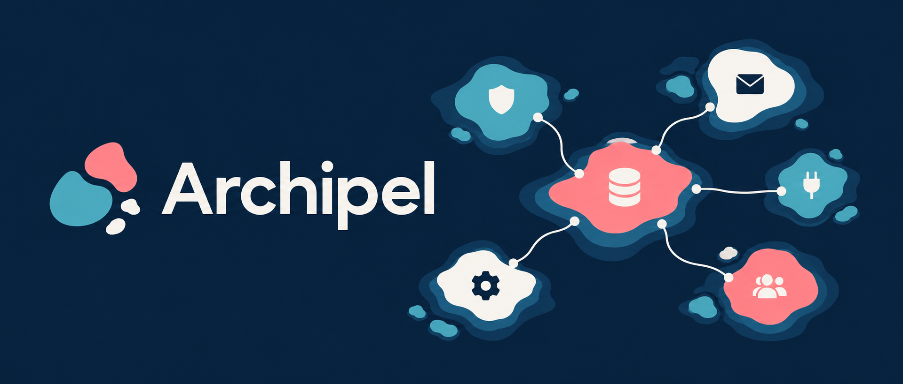

<p align="center">
  
</p>

# Archipel

**Build your NestJS backend from focused, replaceable platform libraries.**

Typed configuration. Persistence. Identity. Payments. Queues. Observability. AI integrations.
Compose the capabilities your application needs and keep its business rules in your own code.


[](https://github.com/pixel-brewery/archipel/actions/workflows/ci.yml)
[](LICENSE)

[Get started](#get-started) · [Packages](#packages) · [Documentation](#documentation) · [Build from source](#build-from-source) · [Contribute](#contribute)

## Why Archipel exists

Backend applications repeatedly need the same infrastructure: configuration, authentication,
database access, file storage, email, background work and telemetry. Archipel gives those
capabilities a shared set of NestJS modules, typed contracts and explicit extension points.

Abstract base classes serve as contracts and dependency-injection tokens. Built-in provider
adapters and application-owned implementations use those same contracts. Provider-specific
entry points let you select an integration together with its SDK dependencies.

Install the packages you need, register their modules and supply the application-specific
adapters. Your application owns its entities, authorization decisions and workflows.

## Get started

Use **Node.js 22.18.0 or newer**, **NestJS 12** and native ESM. Your application should
declare `"type": "module"` and use TypeScript's `NodeNext` module and module-resolution
settings. See the [getting-started guide](.docs/guides/getting-started.md) for the complete setup.

### Configure package access

The source is MIT licensed. npm packages are distributed through **GitHub Packages** under
`@pixel-brewery`, at `npm.pkg.github.com`. Registry authentication is required even for public
GitHub npm packages.

For Yarn 4, add this scope to your application's `.yarnrc.yml`:

```yaml
npmScopes:
    pixel-brewery:
        npmRegistryServer: 'https://npm.pkg.github.com'
        npmAlwaysAuth: true
        npmAuthToken: '${NODE_AUTH_TOKEN}'
```

Export a GitHub personal access token (classic) with `read:packages` permission as `NODE_AUTH_TOKEN`,
then install the capabilities you need. To start with configuration:

```sh
yarn add @pixel-brewery/archipel-platform-configuration
```

### Register a module

Bootstrap the global configuration service once in your application's root module:

```ts
import { Module } from '@nestjs/common';
import { ConfigModule, EnvironmentConfigStrategy } from '@pixel-brewery/archipel-platform-configuration';

@Module({
    imports: [
        ConfigModule.forRoot({
            strategyFactory: () => new EnvironmentConfigStrategy(),
        }),
    ],
})
export class AppModule {}
```

Features declare their typed keys with `createConfigKey<T>()` and register their requirements
through `ConfigModule.register()`. The [configuration guide](.docs/guides/configuration.md)
covers keys, defaults, environment variables, file-based strategies and discovery.

## Packages

Archipel contains **28 packages: 25 backend libraries, one documentation MCP server and two
Prisma generators**. Backend package names follow `@pixel-brewery/archipel-platform-*`.

| Category               | Capabilities                                                                                     | Start here                                                                                                  |
| ---------------------- | ------------------------------------------------------------------------------------------------ | ----------------------------------------------------------------------------------------------------------- |
| **Foundation**         | Application composition, configuration, Prisma repositories, mapping and cryptographic utilities | [Configuration](libs/platform-configuration/README.md), [Database](libs/platform-database/README.md)        |
| **Identity & access**  | Authentication, sessions, MFA, payments and feature flags                                        | [Authentication](libs/platform-authentication/README.md), [Payments](libs/platform-payments/README.md)      |
| **Infrastructure**     | File storage, resources, caching, queues, email, documents and e-signatures                      | [Queues](libs/platform-queue/README.md), [Blob storage](libs/platform-blob-storage/README.md)               |
| **Operations**         | Health, logging, analytics, telemetry, OpenAPI, reporting and application MCP support            | [Telemetry](libs/platform-telemetry/README.md), [MCP](libs/platform-mcp/README.md)                          |
| **AI & extensibility** | Provider-neutral intelligence APIs, realtime sessions, tools and agent coordination              | [Intelligence](libs/platform-intelligence/README.md), [Agents](libs/platform-intelligence-agents/README.md) |

The [package catalog](.docs/packages/index.md) links the full library set and generated API
reference. Each package README documents its imports, configuration and provider options.

### Developer tools

| Package                                                                                 | Purpose                                                                            |
| --------------------------------------------------------------------------------------- | ---------------------------------------------------------------------------------- |
| [`archipel-mcp`](tools/mcp/README.md)                                                   | Bundled package documentation, guides and patterns for coding tools over MCP stdio |
| [`archipel-prisma-generator-entities`](tools/prisma-generator-entities/README.md)       | TypeScript entity interfaces generated from a Prisma schema                        |
| [`archipel-prisma-generator-json-schema`](tools/prisma-generator-json-schema/README.md) | JSON Schema documents generated from a Prisma schema                               |

All three use the `@pixel-brewery/` npm scope. See the [tool guides](.docs/tools/index.md) for
installation and integration.

## Documentation

Browse the [documentation website](https://pixel-brewery.github.io/archipel/) or read the
same guides alongside the source:

- [Getting started](.docs/guides/getting-started.md) — installation and application composition
- [API reference](.docs/api/index.md) — generated classes, interfaces, functions and configuration keys
- [Configuration and environment variables](.docs/guides/configuration.md) — registration, resolution and discovery
- [Architecture](.docs/architecture/index.md) — library boundaries and extension contracts
- [Guides](.docs/guides/index.md) and [patterns](.docs/patterns/index.md) — integration walkthroughs and reusable implementation patterns
- [Release guide](.docs/guides/releases.md) — versioning, publication, verification and recovery

## Build from source

The workspace pins **Yarn 4.13.0** and uses **Nx 24** with **NestJS 12**.

```sh
git clone https://github.com/pixel-brewery/archipel.git
cd archipel
corepack enable
yarn install --immutable
yarn verify
```

`yarn verify` runs the configured agent, formatting, workflow, lint, test, spelling,
documentation, build and ESM-package checks. For focused work, use the owning Nx project:

```sh
yarn nx run platform-configuration:test --parallel=1 --maxWorkers=1
yarn docs:dev
```

## Contribute

Read the [repository engineering guide](AGENTS.md) for architecture, source conventions and
verification. Use Conventional Commits and pull requests; required checks must pass before
merging into `main`.

Verified source merges request automatic patch releases through GitHub Actions. The
[release guide](.docs/guides/releases.md) explains the two release groups, immutable package
versions and release artifacts. Release automation owns version preparation and publication.

## License

[MIT](LICENSE).
