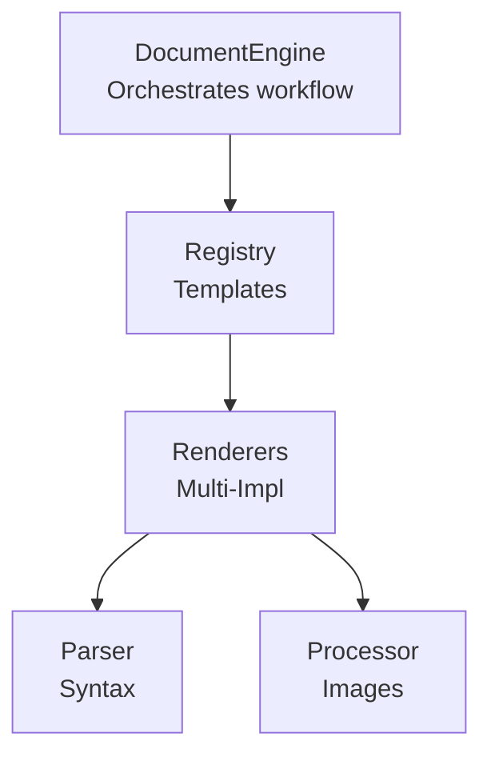

# @pixel-brewery/archipel-platform-documents

Enterprise-grade document engine for PDF and DOCX generation with extensible architecture.

## Features

- **Abstraction-first design** — Interfaces over implementations with clear separation of concerns
- **Extensible renderers** — Multi-provider pattern for DOCX (`docxtemplater` + `pizzip`) and PDF (`pdf-lib`)
- **Template syntax normalization** — Encodian and Mustache/Handlebars syntax to docxtemplater
- **Image processing** — Automatic resize and format conversion via Sharp
- **MIME type detection** — Uses `mime-types` library
- **Debug logging** — `DocumentEngine` emits debug-level logs for format detection and initialization

## Quick Start

```typescript
import { DocumentModule, DocumentEngine, IRenderOptions } from '@pixel-brewery/archipel-platform-documents';
import { SharpImageProcessor } from '@pixel-brewery/archipel-platform-documents/sharp';
import { DocxDocumentRenderer2 } from '@pixel-brewery/archipel-platform-documents/docx';
import { PdfDocumentRenderer } from '@pixel-brewery/archipel-platform-documents/pdf';

@Module({
    imports: [
        DocumentModule.forRoot({
            imageProcessor: SharpImageProcessor,
            renderers: [DocxDocumentRenderer2, PdfDocumentRenderer],
            maxImageWidth: 1200,
            maxImageHeight: 900,
        }),
    ],
})
export class AppModule {}
```

```typescript
@Injectable()
export class InvoiceService {
    constructor(private readonly documentEngine: DocumentEngine) {}

    async generateInvoice(data: InvoiceData): Promise<Buffer> {
        const result = await this.documentEngine.render({
            templateId: 'invoice-template',
            data: { customer: data.customer, items: data.items, total: data.total },
        });
        return result.buffer;
    }
}
```

## Import Options

```typescript
// Main import (module, engine, interfaces, errors)
import { DocumentModule, DocumentEngine, IRenderOptions } from '@pixel-brewery/archipel-platform-documents';

// Sharp image processor (tree-shakable sub-export)
import { SharpImageProcessor } from '@pixel-brewery/archipel-platform-documents/sharp';

// DOCX renderer
import { DocxDocumentRenderer2 } from '@pixel-brewery/archipel-platform-documents/docx';

// PDF renderer
import { PdfDocumentRenderer } from '@pixel-brewery/archipel-platform-documents/pdf';
```

## Architecture Overview



### Core Abstractions

| Abstraction            | Description                                               | Implementations                    |
| ---------------------- | --------------------------------------------------------- | ---------------------------------- |
| `IDocumentRenderer`    | Base interface for format-specific renderers              | `DocxRenderer`, `PdfRenderer`      |
| `DocumentRendererBase` | Abstract base with template loading, syntax normalization | Extended by all renderers          |
| `IDocumentParser`      | Normalizes template syntaxes to docxtemplater format      | `EncodianParser`, `MustacheParser` |
| `IImageProcessor`      | Processes and optimizes images for embedding              | `SharpImageProcessor`              |
| `TemplateRegistry`     | Manages template metadata and file access                 | Concrete singleton                 |

### Dependency Injection Tokens

```typescript
export const IMAGE_PROCESSOR_TOKEN = Symbol('IImageProcessor');
export const DOCUMENT_PARSER_TOKEN = Symbol('IDocumentParser'); // Multi: Encodian, Mustache
export const DOCUMENT_RENDERER_TOKEN = Symbol('IDocumentRenderer'); // Multi: DOCX, PDF
```

## Extending the System

### Adding a New Renderer

```typescript
@Injectable()
export class HtmlRenderer extends DocumentRendererBase {
  public get supportedFormats(): ReadonlyArray<DocumentFormat> {
    return ['html'];
  }

  public async render(options: IRenderOptions): Promise<IRenderResult> {
    // Custom rendering logic
  }
}

// Register in DocumentModule:
{ provide: DOCUMENT_RENDERER_TOKEN, useClass: HtmlRenderer }
```

### Adding a New Parser

```typescript
@Injectable()
export class CustomParser implements IDocumentParser {
  public normalize(data: Record<string, unknown>): Record<string, unknown> {
    // Transform custom syntax to docxtemplater
  }
}

// Register in DocumentModule:
{ provide: DOCUMENT_PARSER_TOKEN, useClass: CustomParser }
```

## Error Handling

| Error Class               | Base Class          | When Thrown                              |
| ------------------------- | ------------------- | ---------------------------------------- |
| `DocumentErrorBase`       | `Error`             | Base class for all document errors       |
| `DocumentRenderError`     | `DocumentErrorBase` | Template rendering failures (DOCX, PDF)  |
| `DocumentValidationError` | `DocumentErrorBase` | Invalid templates, missing placeholders  |
| `ImageProcessingError`    | `DocumentErrorBase` | Image resize/conversion failures (Sharp) |

## Resource Limits

| Limit               | Value      | Description                                         |
| ------------------- | ---------- | --------------------------------------------------- |
| Max image dimension | 8,192 px   | Sharp rejects images exceeding 8192 px width/height |
| Sharp timeout       | 30 seconds | Image processing aborted after 30s                  |

## Peer Dependencies

| Package          | Required | Notes                         |
| ---------------- | -------- | ----------------------------- |
| `@nestjs/common` | Yes      | NestJS core                   |
| `sharp`          | No       | Required for image processing |
| `docxtemplater`  | No       | Required for DOCX rendering   |
| `pizzip`         | No       | Required for DOCX rendering   |
| `pdf-lib`        | No       | Required for PDF rendering    |
| `mime-types`     | Yes      | MIME type detection           |

## Documentation

📖 **Package Docs:** [`.docs/packages/platform-documents/index.md`](../../.docs/packages/platform-documents/index.md)

## Development

```bash
# Build
yarn nx build platform-documents

# Test
yarn nx test platform-documents

# Lint
yarn nx lint platform-documents
```
