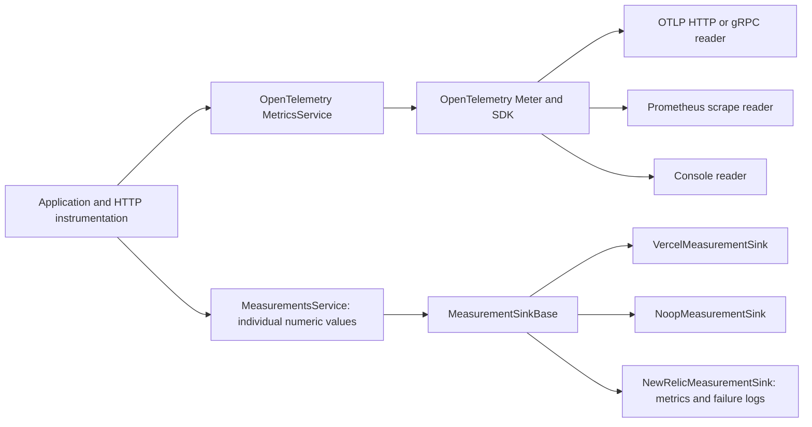

# @pixel-brewery/archipel-platform-telemetry

NestJS telemetry with two independent, tree-shakable recording paths.

## Architecture



OpenTelemetry is the model for counters, histograms, gauges, traces, aggregation, and export. The separate `measurements` path records individual numeric values without claiming OpenTelemetry instrument semantics. Vercel Custom Metrics belongs to that path because its `metric()` API receives one value per call. A generic OpenTelemetry metric exporter receives aggregated values and cannot reconstruct individual histogram observations.

The package root and `/otel` export the OpenTelemetry facade, module, metrics service, logger, rule engine, and SDK holder. `/measurements` exports only the numeric recording contract, module, service, HTTP interceptor, and optional operational diagnostics. Provider SDKs are imported from their own subpaths, have optional peer dependencies, and are absent from unrelated entry points. The OpenTelemetry bootstrap composes `MeterProvider` and `TracerProvider` directly so `@opentelemetry/sdk-node` cannot pull unused metric exporters into the bundle. The package declares `sideEffects: false`.

The OpenTelemetry path requires Node.js 22.18.0 or later, API 1.10, and SDK 3.
Tracing uses `@opentelemetry/sdk-trace` with `@opentelemetry/context-async-hooks`
and `@opentelemetry/core` for asynchronous context and W3C propagation.
These replace the former `sdk-trace-node` and `sdk-trace-base` packages.
See the [OpenTelemetry 3 migration guide](https://github.com/open-telemetry/opentelemetry-js/blob/main/doc/3.x/migration-guide.md).

## Early OpenTelemetry bootstrap and SDK adoption

Use `/otel/bootstrap` when instrumentation must run before the application's first imports of Nest, Express, database drivers or other patched modules. This lightweight entry point exports `initializeOtel`, `ITelemetryOptions`, `IOtelInitResult` and `IOtelSdk` without loading Nest. Keep the application behind a dynamic import, and preserve that boundary in a bundled build:

```typescript
// main.ts: the host supplies server.ts with a bootstrap(sdk: IOtelSdk) entry point.
import { ConsoleSpanExporter } from '@opentelemetry/sdk-trace';
import { initializeOtel } from '@pixel-brewery/archipel-platform-telemetry/otel/bootstrap';

const initialized = await initializeOtel({
    enabled: true,
    serviceName: 'orders-api',
    serviceVersion: 'build-identity',
    environment: 'integration',
    resourceAttributes: { 'deployment.environment.name': 'integration' },
    resourceDetectors: [],
    traces: { enabled: true, samplingRatio: 1 },
    spanExporter: new ConsoleSpanExporter(),
    instrumentation: { http: true, express: true },
});
const sdk = initialized.sdk;
if (!sdk) throw new Error('Telemetry initialization failed.');
const { bootstrap } = await import('./server.js');
await bootstrap(sdk);
```

The host can replace `spanExporter` with any supported OpenTelemetry `SpanExporter`, including its own endpoint, authentication headers, timeout and privacy policy. `extraInstrumentations` accepts host-selected `Instrumentation` instances alongside the built-in HTTP/Express selection. Pass explicitly selected metric readers as the optional second `initializeOtel(options, readers)` argument and enable `options.metrics` to attach them. Archipel registers all selections against the same providers; it introduces no provider-specific settings or secret loader.

`serviceName`, optional `serviceVersion`, `environment` and `resourceAttributes` define the resource. The compatibility default for `resourceDetectors` is environment, process and host detection; select `[]` to export only explicitly supplied metadata and avoid automatic process arguments or host details. The host owns the safety of all supplied attributes. Existing trace sampling defaults to `0.05`; hosts requiring every trace to be selected must explicitly use `1`. Bounded queues and failed exports can still lose telemetry.

Inside the dynamically loaded application, adopt that SDK through the existing module:

```typescript
TelemetryModule.register({
    sdk,
    interceptor: { operation: false },
    httpMetricsInterceptor: false,
});
```

Adoption skips SDK initialization and takes responsibility for its Nest shutdown lifecycle. An adopted SDK already owns its readers; do not construct a second provider or add readers through module registration. With `enabled: false`, the module leaves a supplied SDK under host ownership. Existing `register()` consumers without `sdk` keep the original initialization behavior. For multi-emission streams, disabling the operation interceptor leaves stream lifetime with the host's HTTP or explicitly selected stream instrumentation.

`IOtelSdk.forceFlush(timeoutMillis?)` exports without terminating a warm process. It drains the trace provider queue and then joins the selected exporter's public `forceFlush`, including transports that an automatic SDK batch has already started; metric flushing proceeds independently. Exporters that split their own batches must retain the full operation in their `forceFlush` contract. Provider and transport failures propagate after the available drains finish. `shutdown(timeoutMillis?)` runs once. Both waits default to five seconds, reject on failure/expiry and clear their deadline timers. Startup cleans up partially registered components. `OtelSdkHolder.forceFlush()` offers a safe Nest-facing equivalent that diagnoses optional export failures without rejecting a business operation; it continues accepting legacy shutdown-only SDK references. Retain a flush Promise through the host's serverless lifecycle mechanism when necessary. The deadline bounds waiting rather than cancelling arbitrary exporter work; there is no durable queue or delivery guarantee after a process or function terminates. The host owns early ESM/CJS instrumentation hooks, response completion, exporter transport deadlines and retention.

## OpenTelemetry metrics

Choose one OpenTelemetry reader explicitly:

```typescript
import { Module } from '@nestjs/common';
import { TelemetryModule } from '@pixel-brewery/archipel-platform-telemetry/otel';
import { createOtlpHttpMetricReader } from '@pixel-brewery/archipel-platform-telemetry/otel/providers/otlp-http';

@Module({
    imports: [
        TelemetryModule.register({
            serviceName: 'orders-api',
            metricReaders: [createOtlpHttpMetricReader({ exportIntervalMillis: 15_000 })],
            httpMetricsInterceptor: true,
        }),
    ],
})
export class AppModule {}
```

`TelemetryModule` initializes the OpenTelemetry SDK. `MetricsService` records typed counter, histogram, and gauge measurements through OpenTelemetry instruments. The telemetry facade, operation interceptor, cache recorder, rule engine, and logger remain on this path. `httpMetricsInterceptor` adds HTTP duration and count on the same instruments. Both HTTP interceptors share the route and status handling code. At least one reader is required when `metrics.enabled` is explicitly true; supplying readers enables metrics by default. Multiple readers can export the same instruments to different destinations. Without readers, tracing can still run and the SDK receives an explicitly empty reader list, so metric export stays disabled regardless of `OTEL_METRICS_EXPORTER`.

Available readers are separate entry points:

| Import suffix                | Factory                                        | Destination                                       |
| ---------------------------- | ---------------------------------------------- | ------------------------------------------------- |
| `/otel/providers/otlp-http`  | `createOtlpHttpMetricReader()`                 | OTLP over HTTP                                    |
| `/otel/providers/otlp-grpc`  | `createOtlpGrpcMetricReader()`                 | OTLP over gRPC                                    |
| `/otel/providers/prometheus` | `createPrometheusMetricReader(abstract base?)` | Prometheus scrape endpoint on a long-running host |
| `/otel/providers/console`    | `createConsoleMetricReader()`                  | Local console diagnostics                         |

The OTLP readers use standard OpenTelemetry exporter settings. Prometheus can also receive OTLP over HTTP when its OTLP receiver is enabled; this uses the OTLP/HTTP reader rather than the scrape reader. The Prometheus scrape reader uses `@opentelemetry/exporter-prometheus`; no separate Prometheus client registry or Nest controller is installed.

## Nest provider call traces

`ProviderInstrumentation` uses Nest 12's public `instrument.instanceDecorator` hook to add method spans to explicitly selected application providers and controllers. Pass its bound callback when creating the application:

```typescript
import { NestFactory } from '@nestjs/core';
import { ProviderInstrumentation } from '@pixel-brewery/archipel-platform-telemetry/otel';

const providers = new ProviderInstrumentation({
    include: (instance) => instance instanceof OrdersController || instance instanceof OrdersService || instance instanceof OrdersRepository,
    // classifyFailure: classifySafeFailure, // Optional host-owned machine-readable classification.
    // recordFailure: recordSafeException, // Optional host-owned sanitized exception events.
});
const app = await NestFactory.create(AppModule, {
    instrument: { instanceDecorator: providers.instanceDecorator },
});
```

The host owns provider selection, the OpenTelemetry SDK/context manager, HTTP root spans, exporters and sampling. Select application classes explicitly; avoid framework, logging and telemetry providers. No provider spans are created without an active recording parent. Default spans contain only static provider and method names and safe error attributes. The bridge does not capture arguments, results, SQL, error messages or stacks. Errors get an error status and a generic `Error`/`unknown` type. The optional host classifier may supply safe `error.type`, `failure.kind`, `error.code`, `cause.code` and `http.response.status_code` values (at most 128 machine-readable characters each). Classifier failures cannot replace the original application error.

For sanitized source frames or exception events, the host may supply the synchronous `recordFailure(span, error)` hook. It runs only for failed method spans, receives the original thrown value, and owns the enrichment's privacy policy and size limits. No raw message or stack is recorded by default. The classifier and enrichment hook are isolated independently: either hook can fail without replacing the application error or preventing the span from ending.

Instances keep their identity, private fields, getters and function reflection metadata. Native methods, accessors, symbols, nonconfigurable properties, nonextensible instances and this instrumentation itself remain untouched. Inspection is bounded to sixteen prototype levels and 128 property names per selected instance. Repeated decoration by the same bridge is idempotent. Synchronous returns and thrown values are preserved. Ordinary native promises return an observed chain with the same value or rejection, and asynchronous work keeps its child context. Custom promises and thenables retain their exact identity and are observed only for synchronous invocation; their `then` property is never read. Observable results also retain their identity, lazy subscription, emissions, errors and cancellation. Their method span ends on return; the HTTP root or explicitly owned stream instrumentation measures the stream lifetime. This bridge adds no SDK, exporter, timer or transport.

## Console log correlation

`TelemetryLoggerService` keeps the native `ConsoleLogger` formatting, levels, structured parameters and error stacks. Its optional second constructor argument accepts `ConsoleLoggerOptions`, so a host can retain its prefix, colors, console routing and inspection settings when creating the logger before Nest bootstrap. Nest registration can instead provide those options through `TELEMETRY_LOGGER_OPTIONS`; the existing optional rule-engine constructor argument remains unchanged.

With a valid active OpenTelemetry span, text records include `trace.id=… span.id=…`; JSON records include the same identifiers as root attributes. Outside a valid span, output keeps the native format. Correlation reads only the active identifiers and adds no user, tenant, argument or payload metadata. String messages still reach the rule engine unchanged, including fatal messages. The logger adds no forwarding transport: the host owns log collection and, for text output, extraction of the correlation fields.

## Direct numeric measurements

For Vercel Functions, select the separately published provider entry point:

```typescript
import { Module } from '@nestjs/common';
import { MeasurementsModule } from '@pixel-brewery/archipel-platform-telemetry/measurements';
import { VercelMeasurementSink } from '@pixel-brewery/archipel-platform-telemetry/measurements/providers/vercel';

@Module({
    imports: [
        MeasurementsModule.register({
            sink: VercelMeasurementSink,
            isGlobal: true,
            httpInterceptor: true,
        }),
    ],
})
export class AppModule {}
```

Inject `MeasurementsService` and call `record(name, value, attributes)` for individual values. The HTTP interceptor records request duration and count using stable route templates. `MeasurementsService` also offers the existing HTTP, outbound HTTP, and cache convenience methods. `NoopMeasurementSink` is available from `/measurements/providers/empty`.

Vercel's `metric()` accepts one finite number and string attributes per call. The adapter validates Vercel names and attribute limits and normalizes long attribute values. It does not convert OpenTelemetry aggregates into synthetic observations. Dashboard data appears only after a deployed Vercel Function emits values; each emission is an Observability event. See [Vercel Custom Metrics](https://vercel.com/docs/observability/custom-metrics/).

## Migration and lifecycle

- `MetricClientPort`, `MetricsModule`, and the former `/strategies/*` entry points are replaced by the two explicit paths. The old Prometheus client and controller are replaced by OpenTelemetry readers.
- `OtelMetricClient`, `MetricsService`, `IMetricInstruments`, `TelemetryLoggerService`, and the telemetry facade remain on the OpenTelemetry path. The no-op and Vercel implementations now implement `MeasurementSinkBase` on the numeric path.
- `TelemetryModule.register({ metricClient })` becomes `TelemetryModule.register({ metricReaders: [...] })`. Register `MeasurementsModule` separately when individual numeric values are needed.
- OpenTelemetry SDK shutdown remains bounded by `OtelSdkHolder`. Provider failures are logged without failing business operations.

Use fixed metric names and bounded attributes. Avoid user IDs, tenant IDs, and concrete URL paths as metric attributes.

## Operational diagnostics and New Relic

The optional `diagnostics` registration adds `DiagnosticsService` to the existing measurement path. `complete(operation, durationMs, outcome, context)` emits `${operation}_total` and `${operation}_duration_ms`; `gauge(name, value)` emits a gauge. Use static operation names and bounded context values. `failure(component, operation, error, context, { correlate })` emits `operational_failures_total` and a sanitized local error log. The original thrown object is never serialized.

The host supplies `classifyFailure` and `getCorrelationId` callbacks. Without a classifier, failures have `failure.kind=unknown`, `error.code=UNKNOWN`, and `cause.code=UNKNOWN`. Callback exceptions use that fallback and never replace the application error. A classifier must return only safe attributes. Use `{ correlate: false }` for background work, including work initiated by HTTP. When diagnostics and `httpInterceptor` are enabled, the existing interceptor reports exceptions with status >=500 and rethrows the same value; client errors and guard failures before the interceptor are outside this alarm path. HTTP duration and count still have a single recording owner.

The New Relic adapter is available only through `/measurements/providers/new-relic`. It uses Node's HTTP fetch implementation and needs no New Relic agent SDK. Register its configuration entries and explicit destination options:

```typescript
import { ConfigModule, EnvironmentConfigStrategy } from '@pixel-brewery/archipel-platform-configuration';
import { MeasurementsModule } from '@pixel-brewery/archipel-platform-telemetry/measurements';
import {
    NewRelicMeasurementSink,
    NEW_RELIC_CONFIG_ENTRIES,
    NEW_RELIC_MEASUREMENT_OPTIONS,
} from '@pixel-brewery/archipel-platform-telemetry/measurements/providers/new-relic';

// Application module imports:
ConfigModule.forRoot({ strategyFactory: () => new EnvironmentConfigStrategy() });
ConfigModule.register('observability', NEW_RELIC_CONFIG_ENTRIES);
MeasurementsModule.register({
    sink: NewRelicMeasurementSink,
    isGlobal: true,
    httpLifecycle: true,
    diagnostics: {},
    providers: [
        {
            provide: NEW_RELIC_MEASUREMENT_OPTIONS,
            useValue: {
                region: 'eu',
                attributes: { 'service.name': 'orders-api', 'deployment.environment': 'integration' },
                serviceVersion: 'build-identity',
                durationEvents: true,
                // retain: waitUntil, // optional host lifecycle hook; import it in the host only
            },
        },
    ],
});
```

`NEW_RELIC_LICENSE_KEY` is read through `ConfigService`. An absent or blank key disables export; the host can require it in deployed environments. `region` must explicitly be `eu` or `us`. Resource attributes, build identity, stage policy, secret provisioning and serverless retention belong to the host. Other consumers and providers remain independent of New Relic and Vercel.

Names ending in `_total` become count deltas, `_duration_ms` become one-observation summaries, and other values become gauges. Each count/summary uses `interval.ms=1`. Calls from the same event-loop turn are batched without a periodic timer. The buffer holds at most 500 points; `operational_failures_total` can displace an ordinary point when full. Dropped values are reported as `telemetry_dropped_total` when a later export is possible. One pump processes at most eight batches and drops any remaining backlog.

Every operational failure also produces a targeted Log API entry with `message=Operational failure`, `level=ERROR`, `logtype=operational_failure`, configured resource attributes and `service.version`. `request.id` is retained in these logs and removed from metric dimensions. This is not a console-log drain or complete APM. No SQL, raw errors, stack traces or credentials are read from the thrown object by the exporter.

Metric, log and optional event requests run independently, each with a five-second deadline. Metrics/logs accept HTTP 202; the Event API accepts HTTP 200 or 202. Acceptance does not confirm query visibility. Rejections and network failures produce local warnings without payloads or keys. The optional `retain` callback keeps the export attached to the host lifecycle; its failure cannot fail the caller. Nest shutdown drains for at most five seconds, aborts outstanding HTTP requests, and rejects later recordings. There is no automatic retry, durable queue or guarantee after abrupt process termination. Configure external availability and signal-loss alarms independently of this exporter.

Endpoint and payload contracts follow the official [Metric API](https://docs.newrelic.com/docs/data-apis/ingest-apis/metric-api/report-metrics-metric-api/) and [Log API](https://docs.newrelic.com/docs/logs/log-api/introduction-log-api/) documentation.

## Individual duration percentiles and HTTP completion

Set `durationEvents: true` on `INewRelicMeasurementOptions` to additionally export every accepted `_duration_ms` observation as a `MeasurementDuration` event. It contains `measurement.name`, numeric `durationMs`, original millisecond `timestamp`, bounded measurement/resource attributes and `service.version`. Correlation IDs are removed. Existing count, summary and gauge exports remain unchanged; the default is off. There is no time-bucket averaging or sampling before event export. The same bounded buffer and host retention hook apply, so saturation or transport failure can still lose events. Compare event counts and signal freshness; percentiles are over delivered observations.

Events are gzip-compressed and use the existing ingest license key with `https://insights-collector.eu01.nr-data.net/v1/accounts/events` (EU) or `https://insights-collector.newrelic.com/v1/accounts/events` (US). See the official [Event API contract](https://docs.newrelic.com/docs/data-apis/ingest-apis/event-api/introduction-event-api/).

```sql
FROM MeasurementDuration SELECT percentile(durationMs, 50, 95, 99), count(*)
WHERE `measurement.name` = 'http_request_duration_ms'
  AND `service.name` = 'orders-api'
```

For an Express/Node host, opt into `MeasurementsModule.register({ sink, httpLifecycle: true })`. Middleware measures from entry until `ServerResponse.finish` or `close`, including guard rejections, serialization and unmatched routes. `path` remains the route template or `unmatched`; concrete URLs/query strings are never read. A premature close gets measurement status `499` (not a returned HTTP response). Long-lived streams report their full lifetime when closed. Bootstrap, proxy and hosting failures before Nest are outside this boundary. Fastify is not supported by this option.

The existing interceptor still owns sanitized exception diagnostics. When lifecycle mode is selected it does not emit a second HTTP duration/count, even if `httpInterceptor` is also true. Existing interceptor-only consumers keep their behavior.

To observe host middleware that can finish before Nest routes (CORS, rate limit, body-parser errors), select `httpLifecycle: 'manual'`. The module provides/exports `MeasurementsMiddleware` but does not register it automatically. Install it once, before those host middleware and before `app.init()`/`listen()`:

```typescript
import { MeasurementsMiddleware } from '@pixel-brewery/archipel-platform-telemetry/measurements';
const middleware = app.get(MeasurementsMiddleware);
app.use(middleware.use.bind(middleware));
```

Manual mode also disables interceptor duration/count recording, preserving a single owner. An early host response without a bound Nest route has `path=unmatched`. `httpLifecycle: true` retains automatic Nest-route middleware registration for hosts that need only that boundary.
