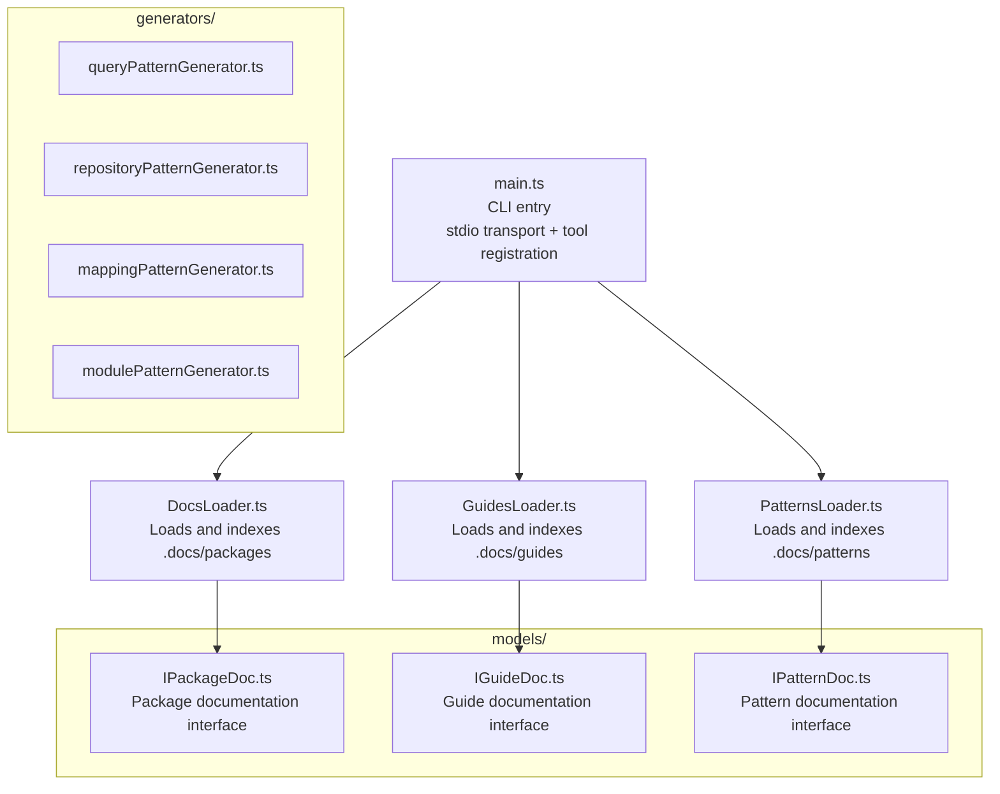

# @pixel-brewery/archipel-mcp

MCP (Model Context Protocol) server that provides Archipel platform knowledge - documentation and query patterns - to AI development tools. The server acts as a structured knowledge provider: AI models combine this knowledge with the user's project context to generate framework-compliant code.

> [!IMPORTANT]
> This package is hosted on GitHub Packages. Configure the `@pixel-brewery` scope
> and a GitHub personal access token (classic) with `read:packages` permission
> before using it. See the
> [package access setup](../../.docs/guides/getting-started.md#install-the-foundation).

## Usage

### VS Code MCP Configuration

Add to your `.vscode/mcp.json` (or global `settings.json`):

```json
{
    "servers": {
        "archipel": {
            "type": "stdio",
            "command": "npx",
            "args": ["-y", "@pixel-brewery/archipel-mcp"]
        }
    }
}
```

### Direct Execution

```bash
npx -y @pixel-brewery/archipel-mcp
```

## Tools

| Tool                | Description                                                                                  |
| ------------------- | -------------------------------------------------------------------------------------------- |
| `list-packages`     | Lists all Archipel platform packages with descriptions and tags.                             |
| `get-package-doc`   | Returns the full documentation (overview + API reference) for a specific package.            |
| `search-docs`       | Searches across all documentation by keyword or phrase.                                      |
| `get-query-pattern` | Returns the v1 query pattern docs (interfaces, factories, rules). Optionally model-tailored. |

### get-query-pattern

Returns the complete Archipel v1 query pattern: `IRepositoryQuery` interface, `query()` factory, `QueryResultType`, transactional queries, rules, and usage examples. When a `modelName` and `fields` array are provided, it generates tailored `findFirst`, `findMany`, and `count` query examples for that model.

```
modelName?: string   - Prisma model name (e.g. "User")
fields?: string[]    - Field names (e.g. ["id", "email", "name", "createdAt"])
```

## Architecture

Plain Node.js MCP server using `@modelcontextprotocol/sdk`. No NestJS, no DI container.



### Documentation Resolution

The server locates docs in this order:

1. **Bundled data** - `<package>/data/packages/` (shipped with the npm package)
2. **Workspace root** - `<cwd>/.docs/packages/` (monorepo development)
3. **Relative fallback** - walks up from compiled source to find `.docs/packages/`

## Development

```bash
# Build
npx nx build mcp-server

# Run locally (from workspace root)
node dist/tools/mcp/src/main.js
```

## License

See [LICENSE](../../LICENSE).
